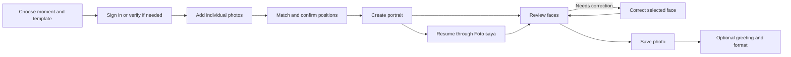

Method: dual-agent (A: `/root/design_review` · B: `/root/technical_review`), with parent route/account review and synthesis.

# MomenRia design and flow audit

9 October 2026 · Impeccable 4.3.1 + project-local UI/UX Pro Max

## Recommendation

Revamp the creation and review experience around a guided portrait journey. Keep the warmth, Indonesian voice, real template imagery, and privacy protections. Give the working screens a quieter, more compact layout than the marketing pages.

The core product is substantially implemented. The largest opportunity is making the next decision obvious: choose a setting, match each photo to a person, create, review each face, then save. A new framework, a new font family, or more animation would not solve the principal problems.

This is an audit and proposed direction, not an implemented redesign or an approved replacement design system.

## Scores and executive findings

**Design: 24/40. Technical quality: 13/20.** Both sit in Impeccable's “Acceptable — significant improvements needed” band. These are expert-review scores, not a measured customer satisfaction rating, conversion result, or accessibility certification.

The consolidated backlog contains **17 findings: 0 demonstrated P0, 7 P1, 9 P2, 1 P3**. Most importantly:

1. Make account-access help reachable before successful login/verification.
2. Keep mobile face assignment, generation and saving actions close to their context.
3. Connect face feedback to correction and persist review progress per result version.
4. Make demo/readiness and expiry copy truthful and consistent before personal uploads.
5. Repair the two verified contrast failures and harden asynchronous status/focus behavior.

| Nielsen heuristic | Score / 4 | Main reason |
|---|---:|---|
| Visibility of system status | 2 | Good stage labels; face review has no durable visible status |
| Match with the real world | 3 | Relevant Indonesian occasions and voice; reference jargon remains |
| User control and freedom | 3 | Drafts, undo, prior versions and revocation; weak expired-state exit |
| Consistency and standards | 2 | Cohesive app, inconsistent account action hierarchy |
| Error prevention | 3 | Consent, validation and confirmations; correction loses target context |
| Recognition rather than recall | 2 | People must remember face numbers and review decisions |
| Flexibility and efficiency | 3 | Batch upload, reuse, versions and exports already exist |
| Aesthetic and minimalist design | 2 | Strong marketing identity, crowded working flow |
| Error recognition and recovery | 2 | Good upload recovery; account-help and expired-source gaps |
| Help and documentation | 2 | Broad coverage, mostly text and weak contextual recovery |
| **Total** | **24/40** | All ten apply to the combined product; none marked n/a |

| Technical dimension | Score / 4 | Main reason |
|---|---:|---|
| Accessibility | 2 | Two verified contrast failures; status/focus risks |
| Performance | 3 | Lean assets/runtime; public views await private initialization |
| Responsive design | 3 | Measured reflow and main touch targets work; essential text is small |
| Theming | 2 | Tokens exist; literal colors and state combinations drift |
| Implementation integrity | 3 | Product-specific system with localized inconsistencies |
| **Total** | **13/20** | Targeted technical fixes are justified; a stack replacement is not |

**Implementation integrity: qualified pass.** Portraits, Indonesian moment collections, numbered face placement and retention controls make this a recognizable product. The detector reported **75 occurrences across nine rule types**, not 75 independent bugs. Source-only scanning missed the dynamically rendered surface; five exported rendered views resolved the real stylesheet and provided useful coverage. Cream/lilac palette warnings were rejected as design preferences, as were gray-on-color failures where measured contrast actually passed. Repeated small-text findings were consolidated. The closing CTA hover failure and guide heading skip were verified; manual measurement also caught placeholder contrast. See [Assessment B](assessment-b.md) and its raw evidence for the complete disposition.

**Keep:** the local voice and photography; public browsing; reusable sources and batch recovery; immutable versions; honest synthetic labels; visible source/result expiry; scoped and revocable staff image access; native controls, visible focus, and existing reduced-motion behavior.

## Evidence and boundaries

- Primary deployed surface: `templates/app.html`, `static/app/server.js`, `static/app/server.css`, branded account templates, installed allauth account/MFA routes, and Django admin registrations.
- Independent Impeccable assessments: [design review](assessment-a.md) and [technical evidence](assessment-b.md). The design reviewer did not receive detector output. Parent synthesis also inspected account settings and mapped operational and legacy surfaces.
- Live browser review used disposable local Django servers, test accounts, fictional catalog-face fixtures, and the synthetic worker. Existing database, private media, payment services, and real AI were not used.
- Fresh `npm run test:e2e`: **34 passed (1.9m)** on desktop Chromium and mobile WebKit. [Run record](evidence/e2e-run.txt). Failure/latency cases in that suite sometimes intercept responses; passing them is not evidence of real provider reliability.
- The existing appearance test covers 360, 390, 430, 600, 820, 1024, 1366, 1440 and 1920 CSS-pixel widths for home, catalog and guide. It does not prove every page works at every size, or replace a physical-phone test.
- The shared catalog renderer and inventory cover 28 templates across six collections. Representative family, holiday, graduation, couple and baby screens were inspected; this is not an independent visual or likeness approval of all 28 source images.
- Staff screens and inactive/conditional authentication and payment branches have source coverage, not authenticated staff or payment-provider walkthroughs. Full security enrollment, real verification email delivery, real AI likeness, and a screen-reader conformance audit remain outside the evidence.
- `RTK.md`, referenced by the supplied AGENTS instructions, was not found in the workspace, its parent instruction paths, or the searched Codex files. No replacement instruction was invented. This workspace is not a Git checkout, so no Git diff/commit baseline is claimed.

Evidence labels below: **Observed** = live browser or freshly generated screenshot; **Source** = implementation-supported finding; **Proposal** = design recommendation to validate with people. Severity is impact, not implementation difficulty. P1 means major; P2 means a meaningful improvement with a workaround. No end-to-end P0 failure was demonstrated.

## Product truth the redesign must preserve

MomenRia makes private AI portraits from individual photographs. Customers can choose one to four people, upload JPEG/PNG with permission, maintain face-position assignments, create results, review likeness, correct one face at a time, add greetings, compare immutable versions, and download a watermarked preview. The current release disables purchases. Source and result retention are different; the configured defaults are 7 and 30 days. Downloading, framing or adding greetings must not imply longer retention or extra image detail.

Keep server ownership, verified-email gating, consent, source validation, immutable results, capacity limits, correction constraints, staff access grants, revocation, and deletion safeguards. Simplifying the interface must not weaken these guarantees.

## Page and state inventory

These are rendered surfaces, not just URL counts. A single route can represent a draft, processing state, result, expired result or unavailable project.

| Surface / entry | Current experience and coverage | Recommended change |
|---|---|---|
| Home `/#/` | Observed. Warm voice, family photography, strong headline, how-to, privacy, FAQ, closing CTA. | Put a clearly labelled source-photo-to-portrait explanation close to the first CTA. If using real outputs, use permissioned, representative results; do not present template art as proof of likeness. Show the free watermark/size limit near the promise. |
| Catalog `/#/templates` | Observed + E2E. Six collections, search, people count; search correctly shows matching templates directly. | Keep collections for exploration; give returning visitors a compact template grid and preserved search/filter state. Use an explicit “Pakai template” action instead of making an arrow explain its destination. |
| Hari raya & perayaan collection | Shared renderer; observed representative holiday flow. Nine templates. | Maintain occasion filter and people count; show composition/face positions before commitment. |
| Wisuda collection | Observed + E2E. Eight campus variants with university and background information. | Keep campus filter prominent. Keep the disclosure that scenery/regalia are AI illustrations, not official campus photography. |
| Ulang tahun collection | Shared renderer, source + catalog coverage. Two variants, including different people counts. | Make child/family versus solo composition easy to compare without implying free-form changes to the template. |
| Cerita cinta collection | Shared renderer, source + catalog coverage. Four templates. | Show clothing and setting succinctly; retain the same selection pattern as other collections. |
| Menanti & menyambut si kecil | Shared renderer, source + catalog coverage. Three templates. | Put the relevant parent/guardian permission explanation at upload in both single and batch paths, while preserving actual provider eligibility checks. |
| Kebersamaan keluarga | Shared renderer, source + catalog coverage. Two templates. | Emphasize people count and positions; do not require users to infer composition from names. |
| Template detail `/#/template/:id` | Observed + E2E. Example, attire, people count, upload limits, free output, AI caveat. | A compact decision sheet: large portrait, “Siapkan 2 foto”, composition labels, output facts, one CTA. On mobile, keep the CTA reachable without covering content. |
| Empty/filtered catalog | Observed + E2E. Result count and “Hapus filter” recovery. | Keep this. Show active filters as removable controls and retain them when returning from detail. |
| Missing/paused collection or template | Source + E2E for paused/unknown routes. | Distinguish unavailable template from nonexistent link; offer a compatible alternative, retain the saved draft and avoid silently replacing it. |
| Studio `/#/studio/:templateId[/:projectId]` | Observed + E2E. Preview with numbered markers, uploads, template selector, references and create action. | Convert into a guided workspace with compact progress, recognisable person thumbnails, a stable primary action and optional detail collapsed. Keep portrait and assignment context visible together. |
| Login/upload gate | Observed. Browsing is public; first upload requires login and verified email. | Say “Masuk untuk menyimpan fotomu” before the user opens a chooser. Keep the selected template and destination visible throughout authentication. |
| Single-photo upload | Observed + E2E. Native picker, format/size rules, permission checkbox, validation error. | Show the selected position and photo preview inside the dialog; include visual good/bad examples at the point of need and connect errors to their field. |
| Batch upload and partial failure | Observed + E2E. Multiple files, numbered positions, per-file progress, successful uploads retained. | Make this the default for multi-person templates. Let users match thumbnails to portrait positions directly; show saved/failed status next to each file and retry only unfinished work. Preserve existing partial-success behavior. |
| Saved-photo reuse | E2E + source. Unassigned, unexpired photos in the current project are reusable. | Surface “Foto di proyek ini” next to upload rather than as a hidden secondary route. Do not imply a permanent cross-project photo library. |
| Template picker / confirmation | E2E + source. Collections in a dialog; changing clears placements but keeps uploaded sources. | Show a before/after composition and a short explicit consequence. After confirmation, guide reassignment using the retained thumbnails. Preserve undo and frozen-project restrictions. |
| Original reference / AI multi-angle review | Observed representative state + E2E. Reference generation, approve/reject, alternative approved reference, expiry. | Keep original photo as the default. Place optional AI angles under “Pilihan lanjutan”; explain benefit and uncertainty before generating. Do not promise better likeness without benchmark evidence. |
| Library `/#/projects` | Observed + E2E. Empty, draft, ready, processing and expired cards share a grid. | Put “Lanjutkan draf” first; group “Sedang dibuat”, “Siap disimpan” and expiring results. Give cards thumbnails, date and a state-specific action. Implement pagination for the existing 50-project cap. |
| Draft detail `/#/project/:id` | Source + E2E. Template, assignment count and resume link. | Show the actual attached-photo strip, missing positions and one resume CTA. Avoid another large introductory hero. |
| Processing: queued, dispatching, processing, finalizing | Observed synthetic flow + source/E2E. Honest labels and reassurance; no invented percentage. | Use a clear status panel with last successful update and return-to-library action. Keep the old result visible during correction. Announce state changes accessibly; do not invent an ETA. |
| Uncertain/failed/cancelled work | Source + E2E with explicit failure-state tests. Earlier photos remain available. | Put the appropriate action beside the state: retry only where safe, otherwise project-specific support. A stale/network status needs visible recovery rather than silent polling failure. |
| Result review | Observed + E2E. Portrait, versions, source references, acceptance, corrections, greeting, export, new version, help/delete. | Make reviewing faces one coherent task. Pair original/result crops with persistent per-face review state, then expose saving and optional finishing. Keep downloads available when appropriate; do not add a forced review gate unnecessarily. |
| Face comparison and feedback | Observed + source. Three answers; dialog closes and a toast confirms feedback. | Persist the latest answer per face/version visibly. “Belum mirip” should lead directly to the available correction action with that face retained. |
| Face correction | Observed + E2E. Enhance or replace source, same-person consent, a new immutable version. | Show the selected person's thumbnail and original/result context. Reveal replacement input only when selected; explain unchanged faces also need checking. |
| Version selection / comparison | Observed + E2E. Number buttons and two images with selects. | Use a thumbnail history with change labels: creation, corrected face, greeting. On phones use a large toggled image or stacked face crops; two small whole portraits are weak likeness evidence. |
| Greeting | E2E + source. 48-character input, save creates a version; face pixels are not regenerated. | Add a live placement preview and character count. Explain that saving creates a new version and does not extend expiry. |
| Download and Story/feed export | Observed + E2E. Original/square/portrait/Story framing; watermark preserved. | One “Simpan foto” sheet with visual format choices, exact dimensions and an honest framing preview. Do not promise native sharing or HD detail that is not implemented. |
| Source expiry / result expiry | Source + E2E representative expired-result fixture. Different windows and disabled correction. | Show “Foto asli untuk koreksi sampai …” separately from “Hasil dapat disimpan sampai …”. Remove the unsupported promise that support can restore expired source photos. Offer a new project or a separately specified re-upload recovery flow. |
| Project deletion | Source + E2E. Password, acknowledgement, immediate access removal and queued file deletion. | Keep confirmation, include project thumbnail/name and affected items. Put deletion in a project-management section rather than beside creative completion actions. |
| Guide `/#/guide` | Observed + E2E. Good/bad written photo criteria, workflow, retention. | Replace much of the initial reading with annotated visual examples, then link directly back to the interrupted task. Reuse the same examples in upload dialogs. |
| Support `/#/support[/:projectId]` | Observed + E2E. FAQ, ticket form, optional 24-hour image access and revocation, reply/status cards. | Move relevant project help ahead of generic FAQ on contextual entry. Add an unauthenticated account-recovery route and a real follow-up path for “Menunggu jawabanmu”. |
| Privacy `/#/privacy` | Observed + source/E2E. Specific retention, AI processing, permission, support grants, deletion constraints. | Start with a concise summary of data, recipients, time limits and user controls. Resolve public-service versus demo wording from actual operating mode before launch; do not invent provider guarantees. |
| Terms `/#/terms` | Observed + source/E2E. Free-phase rules, AI limitations, no payments. | Add a scannable summary and retain detailed terms. Remove operational draft language only after the operator confirms the actual release facts. |
| Signup / login | Observed + E2E. Consistent brand; default form labels/help mixed with informal surrounding copy. | Make compact, task-focused forms. Keep password policy, simplify its presentation, offer password visibility, remove duplicate recovery links, and show the chosen template during signup. |
| Verification sent / confirmation / invalid link | Sent page observed; templates/source reviewed. | Show recipient when safely available, resend with cooldown, change-email path and a way to reach help before successful verification. Confirm and invalid-link states should offer a clear next step. |
| Password reset / sent / invalid key / completed | Source; reset entry exercised by E2E. | Maintain anti-enumeration wording; add explicit return-to-login on completion and a reachable help path. Real email delivery and token completion were not tested. |
| Email management | Observed. Primary, resend, remove and add actions all use the same orange button style. | Make current verified email a summary; show eligible actions contextually, separate destructive removal, and avoid offering meaningless “make primary” emphasis on the current primary address. |
| Password change/set / reauthentication / inactive account | Change observed; other inherited conditional templates source-covered. | Use a compact account shell with current section, back-to-photos link and clear action/result copy. Keep security validation and reauthentication. |
| Security / MFA | Index observed. Activate/deactivate TOTP, authenticate/reauthenticate, recovery-code view/generate/download routes source-covered. | Scope heading sizes and give each security state a clear status, explanation and action. Enrollment and recovery codes are security tasks; avoid the large promotional column on every screen. No enrollment was performed. |
| Logout | Source; route linked in browser. | Keep POST confirmation and explain return destination. A secondary action in account navigation is enough. |
| Orders / checkout / master download | Source + disabled-route E2E. Current release hides purchases. | Keep disabled now. Before enabling, design payment initiation, pending, refresh, expiry, failure, paid entitlement, refund and download states end-to-end; the current order list alone is insufficient. |
| Unknown route / startup failure / JavaScript disabled | Source + E2E for unknown/startup; noscript source. | Preserve retry and useful public navigation. Render public marketing/help independently of session/catalog failure where practical. |
| Django admin and staff access | Admin source coverage; MFA middleware source. Users, templates/slots/offers, projects/sources/references/results, jobs/cost/admission, orders/entitlements/refunds, tickets/grants, audit/deletion/alerts and analytics. | Keep Django admin and its access boundaries. Improve list columns, search and filters around daily tasks; begin with job failures and support queues. Add safe contextual links and grant state. A custom dashboard is not justified until staff workflow is observed. |
| Legacy root prototype | `index.html`, `app.js`, `model.js`, root `styles.css`; source reviewed. Studio/editor, library, pricing/orders/order detail, guide/privacy/support, six operator tabs. Not served by Django root. | Explicitly archive or label it as historical design reference. Its one-generation/one-correction quota, Rp19.900 simulated checkout, browser-only privacy and local operator UI conflict with the current product. Do not import those rules into the revamp. |

## Prioritized findings

### F01 · P1 · Account recovery sends blocked users toward authenticated help

**Source; verification page observed.** `templates/account/verification_sent.html` and `password_reset_done.html` direct people to Help if mail never arrives. `static/app/server.js:315` requires login to submit a ticket, while `momenria/settings.py:144` makes email verification mandatory. A person who cannot verify or recover an account may be unable to use the proposed escalation route. The verification-sent template also has no resend/change-address control.

**Change:** provide a narrowly scoped public account-access form or actual monitored contact method, with anti-abuse controls; add resend/change-email recovery where the authentication library permits. Show the intended template/destination throughout the flow. Do not invent a support address or response SLA. **Acceptance:** a logged-out person with a missing verification/reset email can reach a real recovery option without first signing in. **Commands:** `impeccable harden`, `impeccable onboard`.

### F02 · P1 · Face assignment and creation require too much scrolling and translation

**Observed + Source.** `static/app/server.js:272` puts template controls, per-face uploads, optional character references, undo, create and legal copy into one long sidebar. It stacks below the portrait under 900px (`server.css:432`). People must remember what “Wajah 1” corresponds to while moving between the canvas and controls. This is the most important pre-generation decision.

**Change:** a compact “Template → Foto → Cek posisi → Buat” flow, photo thumbnails attached to position labels, batch upload for multi-person portraits, and a stable action area. Put optional multi-angle references behind deliberate disclosure. Keep all source/consent validation. **Acceptance:** on 390px, the selected person, attached photo and next action can be understood together; no user has to memorize the face numbers. **Commands:** `impeccable shape`, `impeccable distill`, `impeccable adapt`.

### F03 · P1 · Result review does not retain an actionable review state

**Observed + Source.** `static/app/server.js:192` opens a useful face comparison. `server.js:509` saves feedback, closes the dialog and shows a toast. `projects/api.py:43` returns result metadata but no latest per-face feedback state. The main page still asks whether faces match and spreads comparison, correction, versions and download across separate controls.

**Change:** make a per-version face checklist with original/result crops and visible “Belum dicek / Sudah mirip / Perlu koreksi”. A negative answer should offer the relevant correction with that face selected. This requires a small API extension to expose latest review state; a visual checkbox alone would not survive reload. Reset review indicators appropriately for a newly generated version. **Acceptance:** users can resume review after refresh and know which face needs attention; they can correct it without reselecting it elsewhere. **Commands:** `impeccable shape`, `impeccable harden`.

### F04 · P2 · Status and keyboard continuity need targeted hardening

**Source.** `jobNotice()` uses the general `notice()` markup, which has no live-status semantics (`server.js:44,286`). Polling replaces the main subtree without moving focus (`server.js:557–559`), and polling failures are swallowed. Version selection also rebuilds the subtree with `focus:false` (`server.js:523`). Existing toast and form alerts are good, but they do not establish that background progress or focus survives these transitions.

**Change:** keep a stable status region, announce meaningful stage changes once, preserve or deliberately restore focus after updates, and show loss of status connectivity without encouraging duplicate generation. **Acceptance:** keyboard navigation continues from the relevant control after version changes; screen readers announce processing completion and failure without reading the whole page repeatedly. Manual assistive-technology testing is required to establish compliance. [WCAG status messages](https://www.w3.org/WAI/WCAG22/Understanding/status-messages.html), [focus order](https://www.w3.org/WAI/WCAG22/Understanding/focus-order.html). **Commands:** `impeccable harden`, `impeccable audit`.

### F05 · P1 · Retention recovery copy overpromises

**Source.** The result page says “Hubungi Bantuan untuk memulihkan foto sebelum koreksi” once references expire (`server.js:299`), while privacy/terms explain that files expire and deletion may be permanent. The reviewed support API has ticket creation and access grants, not source restoration. The expired-result screen offers help/deletion but no direct new-project route.

**Change:** state which asset expired and what is still available. Remove the restoration claim unless an actual recovery procedure is established. Offer “Buat proyek baru”; design any same-person re-upload recovery as an explicit backend-supported capability. **Acceptance:** no expired/deleted file is promised recoverable, and every expired screen has a truthful next step. **Commands:** `impeccable clarify`, `impeccable harden`.

### F06 · P2 · Support asks for an answer but has no reply control

**Source.** `server.js:8` maps `action_required` to “Menunggu jawabanmu”. `loadSupport()` (`server.js:435`) displays messages/replies and revoke controls, but no response action. `operations/api.py:17` only supports reading tickets and creating new ones. Users would have to create a disconnected ticket to answer.

**Change:** add an owner follow-up action/thread linked to the existing ticket, or use a status that matches the actual one-message workflow and explicitly explain how to continue. **Acceptance:** every “waiting for you” ticket contains the action needed to resolve it. **Commands:** `impeccable harden`, `impeccable clarify`.

### F07 · P2 · Account settings flatten action importance

**Observed + Source.** On `/accounts/email/`, “Jadikan email utama”, “Kirim ulang email verifikasi”, “Hapus email” and “Tambah email” all receive the same orange styling from `.auth-card button` (`server.css:318`). The shared global H2 scale makes the MFA subsection headings compete with the page title. [Email evidence](evidence/account-email.jpg), [security evidence](evidence/account-security.jpg).

**Change:** a dedicated compact account layout; one primary action per section, quieter secondary controls and a clearly separated destructive action. Scope 20–24px subsection headings to settings rather than inheriting marketing typography. **Acceptance:** a glance distinguishes current status, safe next step and removal. **Commands:** `impeccable typeset`, `impeccable distill`, `impeccable harden`.

### F08 · P2 · Catalog back-navigation loses discovery context

**Source.** `render()` clears filters when re-entering collections (`server.js:323–326`) and always scrolls to the top on navigation (`server.js:336`). Collection browsing and global search work, but browsing several details can require reconstructing the search position.

**Change:** preserve selected filters and scroll per catalog route, preferably in shareable query parameters or a small navigation-state model; distinguish explicit clear from back. Keep the existing direct global-search behavior. **Acceptance:** back from a detail returns to the same results and position. **Commands:** `impeccable harden`, `impeccable shape`.

### F09 · P2 · Returning users lack a useful library hierarchy

**Observed + Source.** Cards share template names and “Buka proyek” regardless of state (`server.js:279–285`). The API limits the library to 50 projects (`projects/api.py:51`), while project detail is looked up inside that list (`server.js:291`). Consequently, a project outside the returned window can appear missing even though a detail endpoint exists. This edge case is source-derived, not manually reproduced with 51 projects.

**Change:** state-specific actions, recent draft first, expiring-result cues, pagination, and fetch detail directly for a requested project ID. Avoid demanding personal names to organize photos. **Acceptance:** project 51 remains discoverable and a valid older project URL resolves; drafts and finished photos are distinguishable without opening each card. **Commands:** `impeccable shape`, `impeccable harden`.

### F10 · P2 · Mobile comparisons shrink the evidence people need

**Observed + Source.** Version comparison stays two columns at small widths (`server.css:585–603`). In the mobile screenshot, each entire portrait is only a small portion of the dialog; facial differences are difficult to judge. A separate zoom exists for a single result but not linked, synchronized comparison.

**Change:** use a large same-position toggle between versions, or stacked face crops with the selected face held constant. Maintain labeled native controls and an accessible alternative to any gesture. **Acceptance:** the face is large enough to inspect without repeated horizontal/vertical navigation, and the version being viewed is unambiguous. **Commands:** `impeccable adapt`, `impeccable shape`.

### F11 · P2 · Guidance is distant from the moment of uncertainty

**Observed + Source.** The guide explains photo quality through text, while single upload has a generic file control and instructions. Existing validation correctly rejects unsuitable files, but a novice receives the best explanation after leaving their task or after failure (`server.js:383,305`).

**Change:** reuse a small set of annotated, permissioned or synthetic examples showing one face, clear light, adequate size and no face-altering filter; put two or three relevant examples inside upload. Phrase validation as “what happened + what to do next”, near the field. **Acceptance:** a first-time user can choose a suitable photo without reading the full guide. **Commands:** `impeccable onboard`, `impeccable clarify`.

### F12 · P1 · The product promise and operating-mode copy need one source of truth

**Observed + Source.** The home page prominently says “Mulai gratis”; the exact watermark/768px limit is clearest later. Privacy unconditionally discusses unresolved provider information and says not to use private photos “di demo”, even though account-private mode is the normal release configuration (`server.js:310`). Legacy files contain incompatible pricing/quota/privacy rules.

**Change:** define the current release plainly: what works, what a free file includes, and whether this environment is a demonstration. Put the relevant facts at template selection, upload and saving. Keep historical prototype claims out of the live copy. **Acceptance:** a person can correctly answer what file they will receive and where their source photo will go before uploading. **Commands:** `impeccable clarify`, `impeccable document`.

### F13 · P2 · Public content waits for private-app initialization

**Source.** `init()` waits for session, catalog, and—when signed in—project retrieval before rendering any selected route (`server.js:567–572`). `refreshProjects()` then requests session again (`server.js:341–342`). Public help/privacy and landing inherit these dependencies. Image delivery already uses WebP, dimensions and lazy loading; runtime JavaScript is dependency-light.

**Change:** render static public/help content independently where possible; parallelize independent requests and load private project state only when needed. Add responsive image sources if measurements justify it. **Acceptance:** a private-project API failure does not prevent reading privacy/help. Measure on a throttled connection before setting performance claims; local browser success is not a Core Web Vitals measurement. **Commands:** `impeccable optimize`.

### F14 · P2 · Design tokens and information density need separate marketing/app rules

**Source + observed settings.** Tokens exist, but component backgrounds, borders and state colors repeatedly use literal values (`server.css`), and `--green` currently contains near-black. Display type and large section spacing serve the landing well but create long task pages. Secondary captions/navigation labels can be very small on mobile.

**Change:** semantic roles for canvas, surface, text, muted text, action, selected, success, warning and danger. Define separate marketing, workspace and reading scales. Use readable 16px form entry and roughly 14px supporting instructions; reserve smaller captions for truly secondary detail. Do not add dark mode merely to satisfy a checklist. **Acceptance:** new components use the same role tokens and task sections retain visible hierarchy at text zoom. **Commands:** `impeccable document`, `impeccable typeset`, `impeccable adapt`.

### F15 · P1 · Closing CTA becomes low-contrast on hover

**Source + detector + calculated contrast.** `.closing-card .btn` gives the final home CTA cream text on ink. The more-specific shared `.btn.primary:hover` changes only its background to peach (`server.css:28,120`), leaving `#f5f3ec` text on `#ff936f`: **1.959:1**. This is below the 4.5:1 normal-text requirement. No native hover screenshot was available; this finding is supported by the CSS cascade and contrast calculation, not a claimed mouse-hover observation.

**Change:** define foreground/background pairs for each button variant and state. **Acceptance:** default, hover, pressed and focus states each meet text contrast and retain a visible focus indicator. [WCAG contrast](https://www.w3.org/WAI/WCAG22/Understanding/contrast-minimum.html). **Commands:** `impeccable harden`, `impeccable polish`.

### F16 · P1 · Search and form placeholders fail text contrast

**Observed computed styles + calculation.** The placeholder is `#808879` on white (`server.css:177–179`), measured at **3.674:1** for normal-sized text. Visible labels exist, so this is a contrast defect, not an absent-label defect. Placeholders are covered by the text-contrast criterion.

**Change:** use the existing tested muted foreground or another color meeting 4.5:1 on the actual field background. **Acceptance:** catalog search and support placeholders pass in all field states; labels remain visible. [WCAG contrast](https://www.w3.org/WAI/WCAG22/Understanding/contrast-minimum.html). **Commands:** `impeccable harden`.

### F17 · P3 · The guide inherits the wrong heading level

**Observed accessibility tree + source + detector.** The reused `steps()` block has H3 headings, appropriate beneath the homepage H2, but the guide places it immediately after its H1 (`server.js:96,305`).

**Change:** give guide steps the appropriate heading level or a meaningful parent section. **Acceptance:** heading navigation represents the actual structure. A skipped level alone is not being declared a WCAG failure. **Commands:** `impeccable harden`.

## Cognitive load, emotional journey and personas

The strongest memory burden is **selected face → comparison feedback → closed dialog → separate correction selection → generic correction modal**. A single review flow should carry the face, decision and next action across that sequence. The result page also presents acceptance, per-face repair, greeting, download, format, new generation, help and deletion together; grouping exists, but priority is weak. Six moment collections are not inherently a problem: distinguish browsing choices from simultaneous task decisions.

The emotional journey starts well with warm portraits and relevant occasions. Its low points are the unexplained login transition, optional reference terminology, uncertain waiting, and the disconnected correction loop. The result should be the high point; saving should be a confident ending. On the independently measured 390px two-person result, the download action began roughly **1,788 CSS pixels down the document**, after portrait, versions and original references. This is a reachability/hierarchy observation, not a claim that the action is impossible to access.

| Persona used for review | Specific friction | Design response |
|---|---|---|
| First-timer | Expects a photo chooser after tapping a face, reaches login; may interpret “Belum mirip” as starting a correction | Explain the transition, retain the selected template, distinguish feedback from a repair request |
| Interrupted mobile user | Upload/create/save controls are far from the image; no remembered face-review state | Stable task action, thumbnail matching and server-persisted review progress |
| Keyboard/screen-reader user | Helpful semantics exist, but background status and rebuilt controls can lose context | Stable live status, preserved focus, meaningful per-face action names and actual assistive-technology testing |

These are expert walkthroughs, not interviews with recruited customers. Proposed behavior and labels should be validated with users before treating the scores as outcome evidence.

## Proposed revamp: a personal portrait studio

This is a direction to validate, not a claim that a particular visual treatment will improve conversion. The goal is emotional confidence: “I know whose face goes where, what AI is doing, and which photo I am saving.”

### Information architecture

- **Explore:** home, moment collections and template detail. Let the photography carry the emotion.
- **Create:** a focused workspace with template context, matching photos, readiness and generation. It is entered with a selected template and can resume a draft.
- **Foto saya:** a useful return destination for drafts, processing and ready/expiring photos.
- **Account and help:** compact utilities with contextual entry from the task. Help remains reachable from every critical state, including before login for account access issues.

On mobile, test a concise primary navigation such as “Jelajahi · Foto saya · Akun”, with an explicitly labeled help entry. During editing, prioritize the contextual next-step action above the safe area; avoid stacking two competing bottom bars. This is a usability-test candidate, not a universal rule that five tabs are inherently bad.

The visible progress should reflect reality: saving a draft happens throughout, processing may take an unknown time, and an optional greeting must not look like a required step before downloading.

### Key screen composition

| Surface | Main visual | Main decision | Supporting information |
|---|---|---|---|
| Landing | One strong portrait plus clearly labelled individual-source explanation | “Pilih momen” | AI limitations, privacy and free output facts close to the claim |
| Template detail | Full composition, visible person positions | “Pakai template ini” | People count, clothing, photo requirements and output size |
| Studio desktop | Portrait and matched source thumbnails side by side | Complete missing photos, then create | Template change, expiry and advanced references, progressively disclosed |
| Studio mobile | Compact template context, active person preview, photo cards | One stable next action | Readiness count and permission guidance, without long repeated template text |
| Processing | Saved project and plain stage label | Leave safely or seek help when appropriate | Last update, old result, no fictitious countdown |
| Result | Large portrait and a focused face-review strip | Save, or correct the selected person | Persistent review state; history and optional finishing as secondary tools |
| Library | Thumbnails grouped by useful status | Continue, inspect or save | Exact expiry plus relative cue; pagination |
| Account | Current settings and status | One change at a time | Concise explanation, security help, back to photos |

### Visual system proposal

Keep the current Bricolage Grotesque display face and system body font. It is distinctive, locally hosted, and already installed. Keep warm paper, dark ink and a restrained coral accent. Use lilac/lime for selected moments or small branded details; stop giving every task region a decorative treatment.

| Role | Proposed rule |
|---|---|
| Marketing titles | Approximately 44–72px responsive display type; one dominant message |
| Workspace titles | Approximately 28–36px, leaving the portrait visible early |
| Workspace section titles | Approximately 20–24px; avoid competing with H1 |
| Form entries/body | 16px baseline; readable line height and native input semantics |
| Supporting instructions | Approximately 14px; important limitations should not become tiny legal-style captions |
| Spacing | 8px base rhythm; 16–24px within task groups, larger separation between tasks |
| Primary action | One dominant action per current task; active-state colors do not substitute for semantic success/error |
| Touch | 44–48px product target where practical; preserve keyboard/focus and sufficient spacing |
| Images | Large, sharp and uncropped where composition matters; thumbnails only for navigation |
| Motion | Short feedback for a real state change; no parallax or scroll spectacle in the working flow |

UI/UX Pro Max was consulted through its required design-system search plus UX, web and stack searches. The initial automated match recommended app-store CTAs, ratings and a motion-heavy treatment; these conflict with this browser product and available evidence, so they were rejected. Its applicable guidance—field labels, error recovery, progressive feedback, touch sizing, semantic controls and image delivery—was retained. The database is a prompt for judgment, not permission to invent ratings or add unrelated features.

### Copy examples

| Current pattern | Proposed direction |
|---|---|
| “Wajah 1” alone | “Posisi kiri” with matching thumbnail and persistent numbered marker; derive positions from actual template data |
| “Buat foto keluarga” for every group | Contextual “Buat foto” or “Buat potret”, while the template name supplies occasion |
| “Referensi karakter” | “Bantuan menjaga kemiripan” with a concise explanation; optional AI angles explicitly marked as estimates |
| “Semua wajah sesuai” repeatedly | Show saved review state; use “Cek wajah berikutnya” only when review is actively in progress |
| “Hubungi Bantuan untuk memulihkan foto” | “Foto asli sudah melewati masa simpan. Hasil masih bisa disimpan sampai [tanggal].” plus only supported next actions |
| “Buka proyek” on all cards | “Lanjutkan draf”, “Lihat status”, “Cek hasil”, or “Lihat detail” according to state |
| Separate download/format affordances | “Simpan foto” opening clear original/feed/Story options with watermark and dimensions |

Do not require names, ages or family relationships merely to improve labels. A thumbnail and positional label are enough for the core workflow.

## Delivery sequence and verification

| Phase | Work | Preserve / prove |
|---|---|---|
| 1 · Remove avoidable dead ends | Account recovery, truthful expiry copy, actionable support status, status/focus handling; incorporate verified technical-audit blockers. | Login protection, email verification, consent, ownership, no duplicate jobs; focused tests for the actual failure paths. |
| 2 · Redesign creation | Compact studio, thumbnail-to-position matching, batch-first upload, clear preflight and stable mobile action; advanced references disclosed. | Single/solo path, 2–4-person path, partial failures, saved-photo reuse, template-change confirmation, undo, frozen projects. |
| 3 · Redesign review and saving | Per-face review state, direct correction, usable mobile comparison, clearer history, unified export sheet. | Immutable versions, source/result expiry, earlier result access during correction, watermark, entitlement and full-image framing. |
| 4 · Unify discovery and utilities | Context-preserving catalog, useful library, compact account shell, visual guide and mode-correct public copy. | All six moment collections, 28-template inventory, campus disclosures, login return destination, old-project retrieval. |
| 5 · Document and polish | Semantic tokens, intentional responsive scales and bounded desktop/mobile QA. | 320 CSS-pixel reflow, keyboard and screen-reader tasks, text scaling, reduced motion, actual contrast and device input behavior. |

Reuse the current Django/vanilla JavaScript stack. Begin in `static/app/server.js`, `server.css` and account templates. Extend `projects/api.py` for persisted review state/direct detail/pagination only where the design needs it. A support reply or anonymous recovery path requires corresponding endpoint, validation and rate-limit work. Preserve current API and data invariants rather than replacing the backend with browser state.

Relevant existing tests to evolve: `tests/e2e/launch.spec.js`, `competitive.spec.js`, `character.spec.js`, `appearance.spec.js`, account tests and project/result tests. New coverage should target the demonstrated risks, especially unverified recovery, persistent review, focus after updates, expiry and project pagination. Do not add snapshots that merely freeze every pixel.

### User validation

Test the proposed core flow with first-time mobile users, returning users, and keyboard/screen-reader users. Include a solo graduation portrait, a four-person family, one rejected photo, an interrupted draft, a face needing correction and expired references. Ask users to explain the next action, whose face is selected, what file they will receive, and how long it remains available.

Measure time from template selection to a valid ready draft, recoveries after rejected uploads, face-assignment mistakes, completion of face review, downloads after result readiness, and successful resume after interruption. Establish the baseline before promising a percentage improvement. Use anonymous aggregate events without recording source images, identifying face data or raw support text.

### Standards used

- [WCAG 2.2 contrast](https://www.w3.org/WAI/WCAG22/Understanding/contrast-minimum.html): ordinary text 4.5:1; qualifying large text 3:1. Inactive controls and decorative content have exceptions.
- [WCAG 2.2 target-size minimum](https://www.w3.org/WAI/WCAG22/Understanding/target-size-minimum): AA minimum is 24×24 CSS pixels with specified exceptions. The 44–48px recommendation above is a product usability target, not a claim that every smaller control violates AA.
- [Reflow](https://www.w3.org/WAI/WCAG22/Understanding/reflow.html), [status messages](https://www.w3.org/WAI/WCAG22/Understanding/status-messages.html), and [focus order](https://www.w3.org/WAI/WCAG22/Understanding/focus-order.html) guide the proposed verification. This report is not accessibility certification.

Suggested Impeccable sequence: `harden` / `clarify` for recovery, `shape` for the workspace, `distill` and `adapt` for task flow, `typeset` and `document` for the system, `optimize` for measured delivery issues, then `polish`. Re-run `audit` after changes. These can be implemented together or by phase; this audit does not perform them.
