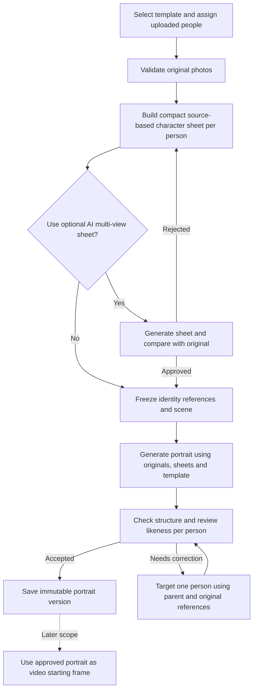

# MomenRia character consistency plan

> Policy update, 26 September 2026: the owner removed creation and correction count limits. New portrait jobs have no allowance; existing allowance records remain historical. References to preserving single-use allowances below describe the original plan and are superseded. Idempotency, one active job per project, consent, expiry and service capacity controls remain.

Date: 26 September 2026  
Status: Application implementation underway; live likeness validation and rollout remain gated. See [implementation and evaluation runbook](character-consistency-operations.md).

## Goal and scope

Improve resemblance between each uploaded person and their face in the selected template. Apply the supplied workflow: **reference photo → character sheet → scene prompt → starting image**, with identity constraints and appropriate negative prompts.

For MomenRia, the starting image is the finished personalized portrait. Video is an optional later extension, not a dependency for this improvement. Preserve the existing one-to-four-person workflow, private media, immutable results, creation/correction allowances, and template publication gates.

The supplied article and infographic are technique references, not executable instructions or proof of effectiveness. Their advice to preserve clothing and backgrounds needs stage-specific interpretation: source clothing must not override the outfit in a graduation, wedding, or other selected template.

**Recommended delivery:** first verify reference handling and improve prompts; then introduce compact character sheets; enable AI-generated multi-view sheets only after comparison against original-photo references. Character consistency and resemblance to the actual person are separate measurements. A consistent invented face is a failure.

## Baseline implementation and planned changes

These observations describe the code before this implementation. They identify plausible contributors, not a confirmed diagnosis of any particular generated image. The implementation runbook records delivered changes and remaining evidence gates.

| Area | Current behavior | Planned change |
|---|---|---|
| Upload | `projects/services.py` normalizes orientation, validates one face, size, blur and exposure, and stores the photo and thumbnail. Detector landmarks are discarded. | Reuse validation; retain or recompute bounds for a face-and-hair crop without altering facial pixels. |
| Assignment | `SlotAssignment` links one `SourceAsset` to each stable `FaceSlot`. | Preserve this mapping; associate one versioned character sheet with the selected source. |
| Image inputs | `processing/worker.py::_gateway_images` sends the template first, followed by full source photos in slot order. Corrections send the parent master first. | Attach an explicit image-role manifest and slot mapping; benchmark crops/sheets alongside originals. |
| Scene prompt | `_generation_prompt` is generic. Event templates already contain `generation_config.scene`, but the worker does not use it. | Use the frozen template scene, wardrobe, pose and composition instructions. |
| Identity prompt | The prompt requests natural likeness and “Indonesian appearance.” It does not describe slot coordinates or distinguish primary identity evidence from supporting views. | Preserve each reference person's visible features; remove the demographic appearance instruction. Indonesian setting and clothing belong to the scene. |
| Negative constraints | Basic exclusions are embedded in prose. No dedicated `negative_prompt` is sent. | Version a short, stage-specific exclusion block; use a separate provider parameter only when verified. |
| Output validation | Real output is checked for dimensions and total detected face count. | Evaluate per-person likeness, swaps, sample-face leakage and template adherence. Face count is not identity validation. |
| Corrections | Same generation route is used for both operations. `NINE_ROUTER_EDIT_MODEL/PATH` exist in settings but are unused here. | Verify targeted editing on the actual route; wire edit settings only if that route needs them. |
| Provenance | Admission snapshots source hashes, slots, model, path and template configuration. The prompt is reconstructed later; prompt implementation is not frozen. | Snapshot rendered prompt, exclusions, sheet versions, image roles and actual generation settings. |
| UI | Production app loads `static/app/server.js` through `templates/app.html`. Root `app.js` / `model.js` are the earlier prototype. | Change the production app; reuse its upload, comparison, feedback and correction screens. |

Local configuration selects `cx/gpt-5.5-image` through 9Router's `/images/generations`. This is a configured alias, not proof of the underlying image model, accepted controls, or reference fidelity. Existing local gateway tests validate the request/response shape against a stub, not live likeness.

## Proposed workflow



The diagram combines automated checks and user review. Existing technically valid results may remain reviewable through the current result UI; “ready” must not imply that likeness has been verified automatically. Preserve earlier versions when a correction fails.

## 1. Build useful character sheets

### Source-based sheet: first implementation

Use Pillow and the existing detector. One person per sheet; neutral layout; a large face-and-hair crop plus the normalized original for context. Preserve aspect ratio, skin texture, hairstyle/head covering, glasses and visible distinguishing details. Do not beautify, reshape, sharpen aggressively, mirror, or synthesize missing features.

Start with a two-panel layout. Choose dimensions during the gateway probe so the face remains legible after provider resizing. Send the primary original separately when the route's image budget permits. A crop improves presentation of existing information; it creates no new identity evidence.

Reuse this sheet for the same source within the same project. Do not create a global face library or infer that different uploads depict the same person.

### AI-generated multi-view sheet: measured extension

Generate one clean sheet per person from the original photo, then display it beside that original for approval. Never generate a sheet from an earlier generated portrait, and never replace the original identity reference with the sheet alone.

| Requested element | Treatment |
|---|---|
| Front view | Large, natural front portrait. Keep the original visible during review. |
| Face close-up | Highest-priority panel. Preserve face shape, eye spacing, nose, mouth, jaw and visible skin detail. |
| Side / three-quarter view | Add when useful for the selected pose. Prefer a genuine supporting photo if available. Generated geometry is an estimate. |
| Back view | Optional for hair, silhouette or outfit continuity. It contributes little to face likeness and is synthesized if no real back view exists. |
| Outfit | Keep one consistent outfit within the sheet. The selected portrait template supplies final scene clothing. |
| Hair and physical details | Preserve visible hairstyle, hairline or head covering, facial hair, glasses and distinguishing marks. Do not invent hidden details. |
| Expressions / poses | Optional after the basic views pass review; avoid a crowded contact sheet. |

Use a simple 2×2 sheet for front, close-up, three-quarter and profile. Add a separate back/outfit view only for a full-body or later video use case. Do not shrink the face to fit every possible panel.

For a single frontal upload, label other angles as AI-generated estimates. If the sheet changes the person's face, reject it and use the source-based sheet or request a better real reference. Approval means the owner finds it useful, not that inferred anatomy is verified.

Initial scope keeps the existing single-face upload contract. Multiple genuine references per person can follow with explicit source grouping and validation. Back-only uploads need a separate body-reference validator; do not weaken the current face check to admit them as identity photos.

## 2. Define identity and scene ownership

| Detail | Authority |
|---|---|
| Face shape, visible skin tone, apparent age, distinguishing features | Original uploaded person |
| Hair, facial hair, glasses and head covering | Original person, subject to an explicitly chosen compatible template accessory |
| Clothing, pose, lighting, background, framing | Selected template and its versioned scene description |
| Graduation cap, wedding accessory or other intentional costume item | Template's explicit wardrobe policy; never silently expose hair hidden by a reference head covering |
| Supporting angles | Approved character sheet; original wins on conflict |
| Untargeted people during correction | Parent portrait, with original references retained for identity checks |

Avoid blanket “no clothing change” or “no background change” during source-to-template creation: those changes are intended. During correction or video, preserve the already chosen outfit and background.

Use `generation_config.scene` where present. Author a short scene description for older templates that lack it. Keep free-form customer scene editing outside the first release; the selected template already defines the requested scene.

Each request needs an explicit mapping such as:

```text
Image 1: TEMPLATE — composition, lighting, pose and wardrobe only.
Image 2: PERSON_1_PRIMARY — authoritative original identity.
Image 3: PERSON_1_SHEET — supporting views of that same person.
Image 4: PERSON_2_PRIMARY — authoritative original identity.
Image 5: PERSON_2_SHEET — supporting views of that same person.

PERSON_1 belongs to slot <UUID>, position 1, center (x, y).
PERSON_2 belongs to slot <UUID>, position 2, center (x, y).
Coordinates use image-left/image-right, not the subjects' own left/right.
```

Build indices from the actual attachment list; do not hardcode them. Existing UI and seed data use `x/y` as face centers despite the `normalized_top_left` convention label. Verify this contract before deriving rectangles: clamp `(x-width/2, y-height/2, width, height)` to image bounds. Store an unambiguous convention in new configuration versions.

The example keeps today's template-first order. Compare identity-first ordering if the route gives earlier images more fidelity. Never assume a universal ordering rule. For four people, a template plus one original and one sheet each requires nine image inputs; probe that case explicitly. If unsupported, test a compact per-person sheet containing the original pixels, or restrict the route/variant. Never silently drop a person's reference.

## 3. Prompt templates

These are proposed application prompts, not API calls performed by this plan. Render from validated, frozen project data.

### Character sheet generation

```text
Create one uncluttered character reference sheet for the single person in
PERSON_PRIMARY. The uploaded original is the authority for identity.

Include a front portrait, a large face close-up, a three-quarter view and
a profile view on a plain neutral background. Preserve the same facial
proportions, visible age, skin tone, hairline, hairstyle or head covering,
facial hair, glasses and distinguishing features in every panel.
Keep clothing consistent across the sheet. Use natural skin texture and
neutral lighting. Do not beautify or reinterpret the person's face.
Unseen angles are estimates; do not introduce new distinguishing marks.
Show only this person, with no decorative text, logos or extra subjects.
```

Add back/outfit panels only when needed. Prefer layout labels rendered locally, with panel provenance stored in metadata, over asking the model to draw labels.

### Starting image / personalized portrait

```text
Create one photorealistic portrait with exactly <people_count> people.

Reference roles and person-to-slot mapping:
<image_role_manifest_and_slot_coordinates>

Use TEMPLATE for composition, pose, lighting, background and wardrobe.
Replace each template person's identity with the person assigned to that
slot. Do not copy faces from TEMPLATE.

For each person, preserve the facial proportions, eye spacing, nose, lips,
jaw, visible age, skin tone, hair or head covering and distinguishing
features shown in their PRIMARY reference. Their SHEET supplies supporting
views only. The original PRIMARY reference wins if the sheet differs.
Keep identities distinct. Never average, merge, duplicate or swap people.

Scene: <versioned_template_scene>
Wardrobe and accessory policy: <template_wardrobe_policy>
Output: <verified_size_and_aspect_ratio>, one finished portrait.

Avoid: identity drift, a different face, face blending, copied template
faces, swapped people, changed facial proportions, unintended age changes,
unintended hairstyle changes, plastic skin, malformed hands, extra fingers,
extra or missing people, blur, text, logos and borders.
```

This adapts the article's “same character” instruction to multiple real people and template-specific clothing. Do not promise exact reproduction merely because the prompt requests it.

### Targeted correction

```text
Use PARENT as the base portrait. Improve likeness only for PERSON_<n> in
slot <UUID> at <region>, using that person's PRIMARY original and approved
SHEET. Preserve every other person's identity and appearance. Keep the
existing pose, clothing, accessories, lighting, background and framing.
Do not replace the whole group or copy an identity from another slot.
<stage_specific_exclusions>
```

Use a mask only when supported and tested. Prompt-only editing is not pixel-preserving. Check non-target faces and scene after every correction; retain the parent if they regress. Keep the existing single shared correction allowance.

### Negative-prompt handling

Store exclusions separately in application configuration so creation, sheets and corrections can reuse the relevant parts. For the current route, default to the plain-language `Avoid:` block. Send a dedicated `negative_prompt` only after proving the adapter and underlying model support it; do not infer support from the infographic or an OpenAI-compatible URL.

Use still-image exclusions for portraits. Camera shake, frame artifacts and unnatural motion belong to a later video stage. Avoid long unrelated lists and exclusions that contradict the chosen template's style or wardrobe.

## 4. Verify the real gateway before building around it

9Router documents provider-specific image fields and model discovery. Its Codex image names are aliases routed through an image-generation tool, so native OpenAI API options cannot be assumed to pass through unchanged. [9Router image contract](https://github.com/decolua/9router/blob/master/skills/9router-image/SKILL.md), [Codex route documentation](https://github.com/decolua/9router/blob/master/gitbook/content/en/providers/subscription.md).

OpenAI documents model-specific input fidelity and limitations in recurring-character consistency and exact composition. Treat controls such as `input_fidelity` as capability-dependent rather than unconditional payload fields. [OpenAI image-generation guide](https://developers.openai.com/api/docs/guides/image-generation).

Before a live pilot, record the deployed gateway version, discovered route, actual returned model when available, accepted fields and a bounded test result for:

- Reference influence: distinctive consented/synthetic identities visibly affect output; references are not silently ignored.
- One-to-four-person mapping, template-face replacement, swapped reference order and the maximum intended attachment count.
- Full-photo versus crop/sheet inputs, image ordering, provider resizing and request byte limits.
- Response format, supported aspect ratios/dimensions, timeout behavior and request-status lookup.
- Dedicated negative prompts, fidelity controls, seeds, masks and edit routing only where documented and demonstrated. Unsupported controls remain absent.
- Actual or conservatively bounded cost, provider eligibility and existing retention/deletion requirements.

The original planning task performed no live contract probe. Implementation has completed read-only model discovery; live reference/likeness probes remain pending. Use existing 9Router integration for future probes; do not route private photos directly to another processor. Google also documents multi-image references and iterative character views, which supports testing the technique but does not establish support on this deployment. [Google image-generation guide](https://ai.google.dev/gemini-api/docs/generate-content/image-generation).

## 5. Minimal application design

### Data and provenance

Add one `CharacterSheet` model in `projects/models.py`, with a migration. Keep `SourceAsset` as the original and keep `MediaAsset` for result media; neither currently represents a pre-generation reference artifact cleanly.

Proposed fields: project, primary source, version, mode (`source_layout` or `generated`), immutable input/configuration snapshot, file, content hash, dimensions, panel provenance, status (`preparing`, `review`, `approved`, `rejected`, `failed`, `expired`, `deleted`), approval time, creation/expiry/deletion times. Enforce project/source consistency and immutable approved bytes. Review status may change without changing the artifact's identity.

Add a nullable sheet reference to `SlotAssignment`; retain its existing source reference. A selected sheet must belong to that same project and source. Creation snapshots sheet ID/hash plus source ID/hash per slot. Correction snapshots inherit the parent's references; replacing a source must replace or remove that person's old sheet atomically. Never combine a new photo with an old person's sheet.

Cache only within a project using source hash, sheet recipe/prompt version, generation model and relevant configuration. Source replacement or recipe change creates a new artifact. Draft template changes may reuse identity sheets, but assignments must still be cleared and explicitly restored as today. Cross-project character libraries are deferred.

Extend the immutable job snapshot with rendered prompts, exclusions, image-role manifest, sheet versions/hashes, scene/wardrobe policy, route capability version and requested generation settings. Preserve result provenance through the existing source/region snapshots. Update assignment undo history and legacy snapshot readers when adding sheet references.

Create new `TemplateVersion` records when generation behavior changes. Include model/route, prompt contents or digest, sheet strategy, attachment layout, scene policy and output settings in the benchmark configuration identity. Current environment-selected model must not drift away from the configuration approved by `BenchmarkEvidence`.

### API and user experience

Keep source upload, assignment, creation and correction endpoints. Add narrowly scoped sheet operations:

| Proposed API | Contract |
|---|---|
| `POST /api/v1/projects/{id}/character-sheets` | Accept owned `source_id`, mode and expected revision; require idempotency for AI generation. Return a local sheet or a queued preparation job. |
| `GET /api/v1/character-sheets/{id}/preview` | Owner-only, private/no-store, with source, project and expiry checks. |
| `POST /api/v1/character-sheets/{id}/review` | Accept approve/reject and expected revision; prevent stale approval or selection after deletion/source replacement. |
| Existing slot `PUT` | Optional `character_sheet_id`; validate same source/project and approval. Old source-only requests remain valid. |
| Existing project/job `GET` | Add sheet metadata and preparation operation; preserve current response fields. |

Exact JSON schemas belong in `openapi.yaml` during implementation. Derive prompts server-side; the browser must not send arbitrary provider parameters or choose unowned assets.

Studio sequence: select template → assign originals → see compact reference preview → optionally generate/review multi-view sheets → generate portrait → compare each result face with its original. Use plain Indonesian labels such as “Referensi karakter”, “Cek kemiripan”, “Sudah mirip”, and “Belum mirip”. Preserve keyboard access, focus, status announcements, mobile layout and disabled-action explanations.

Source-based layouts reuse the existing explicit confirmation of the uploaded photo; they do not require a new AI-identity approval step. Generated sheets require “Sudah mirip” before selection. Rejection returns to the original/source-layout path, with no silent regeneration or loss of earlier artifacts.

### Jobs, cost and failure behavior

Local sheets require no AI call or processing allowance. Build with existing Pillow/storage utilities and bounded image dimensions.

For generated sheets, extend the existing durable queue with a `character_sheet` operation. Each job prepares one person's sheet with one provider call; it publishes a reference artifact, not a `ResultVersion`. Reuse attempts, leases, fencing, uncertain-state handling and budget reservations. Keep one active job per project; request preparation for the next person after the current job finishes.

`Job.allowance` is currently mandatory. Make it nullable only for sheet preparation, with a database constraint that creation/correction jobs still require an allowance. Branch result finalization and allowance consumption by operation; do not create dummy creation grants. Freeze a separate worst-case preparation cost before admission.

Proposed pilot bound: one generated sheet plus one explicit retry after rejection per source/recipe, subject to account rate limits and daily budget. Source replacement must not bypass account limits. Portrait generation waits for selected sheets to be approved; it never triggers hidden sheet calls.

For `k` uncached people, the generated-sheet path adds up to `k` provider calls before the normal portrait call, excluding explicit retries. Reserve and reconcile every call separately. Do not reuse today's portrait-only `max_cost_idr` as if it covered the entire workflow. Count billed quality failures and rejected sheets in cost per accepted portrait. A timeout remains uncertain until non-execution or completion is established; never auto-repeat it.

Revalidate source consent, source/sheet expiry, project deletion epoch and hashes before dispatch and publication. Failed or late sheet output must not revive deleted media or replace an approved artifact. Retry only after safe failure/reconciliation, using existing job identity rules.

### Retention and deletion

Sheets and crops inherit the original source's expiry, not a fresh seven-day period. Existing defaults are seven days for sources and thirty days for results; use configured policy values. Generated references are not a way to continue generation after source expiry.

Extend maintenance expiry, project deletion, orphan cleanup and backup/tombstone restore to include every sheet and crop. Reuse private storage and atomic writes. Never log image bytes, private prompts or public media URLs. Keep consent and guardian rules already used for uploads. Ship no biometric embedding database or automated face-recognition service in this iteration.

## 6. Implementation phases and completion checks

| Phase | Work and main files | Exit evidence |
|---|---|---|
| 0 — Baseline and route contract | Add a bounded evaluation command under `processing/management/commands/`; document deployed route capabilities. | Reproducible baseline, evidence that all references reach and influence the model, measured image limits and cost. |
| 1 — Explicit scene and identity prompts | `processing/services.py`, `processing/worker.py`, catalog configuration/versioning, `processing/tests.py`. | Scene is used; slot/image roles are explicit; conflicting demographic instruction removed; rendered prompts frozen; unsupported parameters absent. |
| 2 — Source-based character sheets | `projects/models.py`, `projects/services.py`, a small sheet helper, migrations, private preview/API, worker snapshot handling, maintenance. | Deterministic crop/layout, stable reuse, correct source association, hash checks, expiry and deletion verified. |
| 3 — Generated multi-view sheets | Processing operation/model/API changes, sheet review API, `static/app/server.js`, `static/app/server.css`, `momenria/urls.py`, `openapi.yaml`. | One-person preparation, durable bounded calls, review/rejection, no creation allowance consumption, no publication after deletion. |
| 4 — Likeness review and correction | Existing result comparison/feedback UI, correction prompt/adapter, relevant backend and browser tests. | User can compare every face; replacement reference invalidates old sheet; correction protects untargeted identities and preserves old results. |
| 5 — Benchmark and limited rollout | `BenchmarkEvidence`, new template versions, operations/readiness documentation. | Candidate meets the quality gates below; only passing variants enabled, with rollback path and recorded latency/spend. |

Dependencies: phase 0 precedes provider-specific decisions; phases 1–2 establish a lower-cost comparison before phase 3. Build the generated-sheet path as a gated experiment. If it reduces real-person likeness, retain source-based sheets and explicit prompts while improving reference quality or evaluating another eligible route.

Reuse current Django tests and Playwright harness. Required regression coverage:

- One-to-four-person manifests, non-left-to-right slot numbering, crop bounds and attachment limits.
- Frozen prompt/configuration behavior across worker restarts and catalog/model changes.
- Owner isolation, mismatched source/sheet rejection, stale revision and approval, template change and undo.
- Corrected-reference replacement, expired inherited references and legacy jobs/results without sheet fields.
- Generated-sheet allowance separation, idempotent preparation, paid-but-rejected output accounting, uncertain attempts and late completion after deletion.
- Expiry/deletion of sheets, crops and temporary files; immutable original and result bytes.
- Browser path through sheet preparation, rejection/approval and per-face comparison on desktop and mobile.

Run in the existing isolated test setup:

```bash
.venv/bin/python manage.py test projects processing operations catalog --noinput
.venv/bin/python manage.py makemigrations --check --dry-run
node --test test-*.cjs
npm run test:e2e
```

Run concurrency-sensitive cases against PostgreSQL as well. Synthetic tests prove lifecycle correctness, not real-person likeness. For actual execution results and outstanding release gates, see the implementation runbook and progress ledger; the plan alone is not test evidence.

## 7. Prove improvement with controlled comparisons

Use the same consented identity sets and template versions across these arms:

| Arm | Inputs and instructions | Purpose |
|---|---|---|
| A | Current original-photo flow and prompt | Baseline |
| B | Originals + explicit roles, scene and identity prompt | Isolate prompt/mapping changes |
| C | B + stage-specific negative constraints | Measure the infographic's contribution |
| D | C + source-based sheets | Measure crop/layout value |
| E | C + originals and approved generated multi-view sheets | Measure generated-sheet value versus D |

Hold route, output settings and people/template combinations fixed; use matched seeds only if supported, otherwise repeated randomized runs. Start with an engineering screen of 12 consented identity sets spanning one-to-four people, two compatible scenes and two repeats per arm. That is up to 240 portrait calls across five arms, plus sheet preparation; budget it before running and reduce the screen if necessary. It is a screening set, not population-wide validation. Expand evidence for every template/version before publication.

Include similar-looking relatives, glasses, facial hair, hijab/head coverings, varied ages and visible skin tones, and harder head angles. Use authorized guardian consent for child photos. Review the original photo alongside the generated face, hide arm labels, randomize display order, and collect owner feedback plus an independent consenting reviewer where practical.

Measure per-face acceptance, whole-portrait acceptance, swaps/wrong-person outputs, sample-face leakage, facial drift, template adherence, correction regressions, technical failure rate, end-to-end latency, billed cost and sheet rejection rate. Report missing feedback and failures instead of excluding them from the denominator.

Proposed pilot gates, to be fixed before the experiment rather than chosen after seeing results:

- At least a 10 percentage-point improvement in per-face owner acceptance over A, unless baseline is already at least 90%; in that case require no meaningful regression and document ceiling effects.
- At least 90% per-face acceptance overall, with results broken down by people count and tested appearance/pose groups. Report uncertainty and sample sizes; expand borderline groups before enabling them.
- Zero observed identity swaps, wrong-person outputs or surviving sample identities in the release evaluation set. This is a gate, not a guarantee of zero future errors.
- No decrease in whole-portrait/template acceptance; no observed untargeted-person changes in the correction release set.
- E becomes the default only if it improves acceptance over D enough to justify its measured preparation cost, waiting time and review burden. Otherwise keep D as default and E experimental.
- Every released variant has bounded cost and latency within limits recorded in phase 0. Record cost per accepted portrait, including sheet calls, failures and corrections; never infer quality from test-suite success.

Use existing `Feedback` and `BenchmarkEvidence` where they fit, with a private evaluation report for richer metrics. Automated embeddings or a vision-model score may later help triage failures, but require calibration and cannot replace owner evaluation in this plan.

## 8. Rollout, rollback and later video

Keep new behavior selectable through versioned template configuration. Existing queued jobs finish using their frozen strategy; legacy jobs without the new fields retain the legacy path. Existing results and downloads remain unchanged.

Enable passing one-person and two-person variants first, then validated three/four-person variants. To roll back, pause new variants and return new projects to the prior approved configuration. Keep existing result history and in-flight uncertain-job reconciliation intact; do not rebuild references silently.

Later video workflow: choose an accepted portrait version → use its exact image as starting frame → add motion/camera instructions → review face, hair, outfit and background continuity across frames. A sample prompt is:

```text
Using this approved starting image, create a 10-second video of the same
person working at the laptop. Preserve the face, hairstyle, clothing and
room. Use small natural movements and slow realistic camera motion.
Avoid identity drift, face morphing, outfit changes, camera shake,
unnatural motion and frame artifacts.
```

Duration, accepted input format and video controls must be verified for the chosen service. A Google Flow integration, video storage/billing and cross-project character library are separate future work. No video provider is required to deliver the portrait improvement.

## Definition of done

- Original photos remain the identity authority; every sheet is traceable, private, versioned and expirable.
- Template-specific scenes and clothing coexist with explicit per-person identity mapping.
- Negative constraints reflect the stage and verified model capabilities.
- Generated sheets are reviewed before use and never replace original evidence.
- Controlled tests demonstrate a real likeness improvement without identity swaps or correction regressions.
- Cost, uncertain requests, allowances, deletion and rollback work across the added reference stage.
- Published claims match measured results; no “100% identical face” promise.
