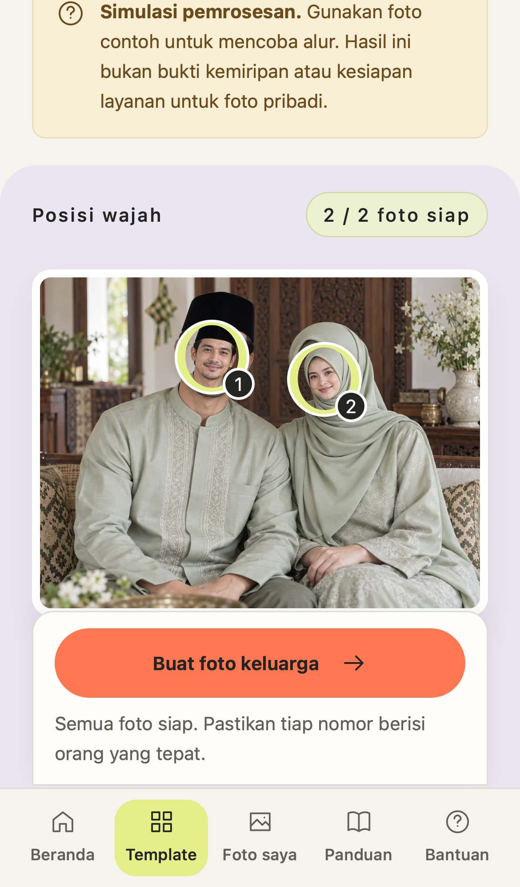

# Implemented design audit recommendations

9 October 2026. Approved incumbent direction, direct code implementation. Private-photo interface prepared; existing release gates retained. This report supersedes the historical audit's implementation status, not its observations.

## Outcome and scope

The changes cover the public home, shared catalog for 28 templates/six collections, detail and campus disclaimer, guided studio, upload/reuse/batch and template change, optional character references, library/drafts/direct older projects, processing and failures, result review/correction/version comparison/greetings/save formats, guidance/policies/public and authenticated support, account recovery/settings/MFA shared layout, and staff inbox/list affordances. Conditional provider, payment and privileged branches retain source/test coverage with no claim of real provider or full staff walkthrough.

Final scoped reviews: **40/40 UX** and **20/20 technical**, up from the original 24/40 and 13/20. The original rubric is retained: ten Nielsen dimensions × 4 and five technical dimensions × 4. [Independent design finish review](re-audit-design.md) and [technical re-review](re-audit-technical.md) document the criteria, evidence and review method. These are bounded implementation review scores, not an assertion of universal usability or production readiness.

## Acceptance ledger

| Finding | Implemented outcome | Evidence |
|---|---|---|
| F01 Account recovery | Real public account-access inbox with CSRF/rate limits; selected published template context survives login/signup/verification and same-browser emailed password reset without broadening redirects. | 22 account tests, operations API tests, public recovery browser case, native reset AX and source re-review. |
| F02 Mobile assignment | Compact five-step journey, batch action, source thumbnails directly at numbered portrait positions, reachable mobile action and optional references behind disclosure. |Ready marker decoded-image assertion, desktop/mobile studio and ready viewport captures, lifecycle test. |
| F03 Persistent review | Latest per-face/global feedback exposed for each immutable result; visible review state survives reload; negative feedback opens the available correction for that face. |Projects API tests and character browser journey. |
| F04 Status/focus | Stable polite status region, stage-change announcements, connectivity retry, preserved navigation/control focus and form drafts, no duplicate-generation guidance. |Browser uncertain-job/offline/focus cases, delayed public/private ticket draft cases, native AX/source. Actual AT announcement compliance unverified. |
| F05 Expiry | Separate source/result deadlines, truthful unavailable-source copy and new-project recovery. |Expired-result/source branches in launch tests and source review. No restoration promise. |
| F06 Support conversation | Owner-only immutable chronological replies tied to existing ticket, waiting state and follow-up action; staff inbox remains audited. |Operations conversation/ownership/CSRF/rate tests and reply persistence browser case. |
| F07 Accounts | Compact forms/settings, active navigation, differentiated safe/destructive actions and native email-remove confirmation. |Final account/security/login captures, 22 account tests and allauth source review. |
| F08 Discovery context | Search, filters and scroll retained per catalog route; explicit clear distinguished from back. |Catalog return regression, global-search browser case. |
| F09 Library | Processing/draft/ready/expired groups, relevant actions, offset pagination, direct older-project retrieval and refresh outside first 50. |Projects API pagination tests and mocked 51-project/older-active browser case with fresh document. |
| F10 Comparison | Selected-face crops synchronized across versions, large stacked mobile panes with named native controls; SVG visibility bug fixed. |Competitive regression checks actual crop visibility/image payload and captures both platforms. |
| F11 Upload guidance | Labeled synthetic suitable/unsuitable examples inside upload, single selected-photo preview, field-specific recovery and preserved batch success. |Invalid upload, lost assignment response and reuse browser cases; synthetic image origin metadata. |
| F12 Truthful release | Actual fake/shared warnings and configured retention; free JPEG watermark/768px explained before upload and saving; historical prototype labeled archived. |Session/API/source tests, home/upload/result captures, PRODUCT.md. Production privacy/likeness gates remain. |
| F13 Public startup | Public-first render with independent parallel requests, per-service failures/retry and useful no-JavaScript account/recovery guidance. |Public guidance session outage, public controls while private load deliberately held, startup failure tests and source fallback inspection. |
| F14 Design system | Semantic foreground/surface/state tokens, compact workspace/read hierarchy, 16px inputs / 14px helpers, readable mobile navigation, authored SVG icons, focus/reduced-motion. |DESIGN.md and schema2 sidecar validation, nine-width layout checks, settled 200% text tests and captures. |
| F15 Hover contrast | Explicit foreground/background pair for closing CTA hover, unchanged visible focus. |Measured desktop hover contrast test ≥4.5:1. |
| F16 Placeholders | High-contrast semantic muted field text and visible labels. |Computed placeholder contrast test ≥4.5:1 and account/source inspection. |
| F17 Guide headings |Guide steps use H2 below H1; homepage steps keep H3 under section H2. |Guide DOM assertion, native/source hierarchy review. |

## Validation and iteration

- Final full browser run: 56 passed, desktop Chromium and iPhone 13 WebKit, 2.5 minutes. [Saved log](validation/browser-final.log).
- Full Django suite: 119 total, 117 passed and 2 existing PostgreSQL-only concurrency checks skipped. [Saved log](validation/django-final.log).
- Final accounts run after template changes: 22 passed. [Saved log](validation/accounts-final.log).
- Legacy Node tests, JavaScript syntax, Django system check and migration consistency passed.
- A final mobile compositing-layer fix keeps Safari taskbar children painted after scrolling; one fresh focused mobile lifecycle passed after the 56-test run, with actual photo/position/action evidence. [Saved check](validation/mobile-paint-check.log).
- Visual/source review independently caught two defects after earlier green tests: hidden SVG crops and asynchronous ticket-reply draft loss. Both were reproduced red, fixed and covered by assertions that test visible output/continuation.
- Finish review added direct source-to-position recognition and consistent SVG icons; both were implemented and verified.
- Full-run test preconditions were hardened for completed sign-in and new-document mocks; production throttling/security remained unchanged.

[Capture packet](../../.impeccable/review/packet.md) records actual capture validity and scope. Invalid or clipped native full-page account evidence was replaced with native top/bottom viewport captures. Synthetic fixtures never establish likeness quality.

## Local performance evidence

Cold fresh-context localhost startup and catalog typing/navigation were measured with no CPU/network throttling. The supported Chromium long-task observer recorded no tasks over 50ms. WebKit does not expose that observer; its trace is reported as unsupported. Resource totals and navigation timings are in [the lab summary](validation/lab-summary.json). Public controls/search also worked while the private projects response was deliberately blocked. This is local lab evidence, not production Core Web Vitals or a mobile-device benchmark.

## Remaining release evidence

Real provider photo privacy/deletion terms, real likeness evaluation, production performance, actual assistive-technology tasks, physical-device safe areas, PostgreSQL concurrency and live proxy-container traffic remain outside this implementation evidence. Existing production/paid launch gates remain enforced; the interface does not certify readiness.
