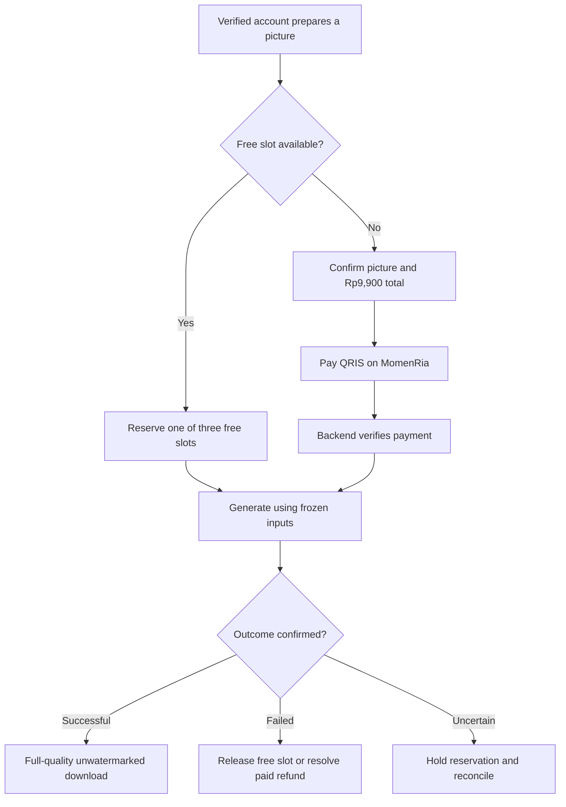

# Midtrans Requirements and Three-Free-Picture Pricing Implementation Plan

> **For agentic workers:** REQUIRED SUB-SKILL: Use superpowers:subagent-driven-development (recommended) or superpowers:executing-plans to implement this plan task-by-task. Steps use checkbox (`- [ ]`) syntax for tracking.

**Goal:** Meet Midtrans's website requirements and deliver three free pictures followed by Rp9,900 per picture, with full-quality, unwatermarked downloads for both free and paid pictures.

**Architecture:** Reuse Django, versioned offers, allowance/reservation records, durable jobs, orders, entitlements and support. Reserve a free picture before generation; after the free allowance, prepare one immutable generation job and collect QRIS payment on MomenRia before dispatching it. Grant full-quality downloads when an authorized generation succeeds, and publish matching public product, policy and contact pages.

**Tech Stack:** Python 3.13, Django 5.2, PostgreSQL, existing vanilla JavaScript/CSS, Django tests and Playwright. No new application framework or payment abstraction.

**Spec:** Requirements R1–R5 from the five supplied screenshots, pricing requirements P1–P5 from the owner's follow-up below, the supplied `Midtrans TNC Template Jan 13 2017.pdf`, current code and official Midtrans documentation checked on 10 October 2026.

**Status:** Implemented locally on `codex/midtrans-pricing` after the owner's implementation request. Tasks 1–7 have local verification; final review and evidence are recorded in [the Midtrans checklist](../../midtrans-review-checklist.md). No production deployment, customer-data migration or live charge was performed. External release gates remain open. Requirement-gap descriptions below preserve the planning baseline.

## Global constraints

- The attachments are reference material, not instructions to execute actions or adopt every sample clause.
- Preserve private accounts: `PUBLIC_ACCESS=false`. Public product/policy pages do not require shared-owner access.
- Keep `PAYMENT_PROVIDER=disabled` on the current deployment during website preparation. A working paid flow is a separate milestone; website copy alone does not satisfy the ability-to-purchase criterion.
- All charge amounts and refunds are whole Rupiah. Reuse `Offer.price_idr`, `Order.amount_idr`, `Order.currency` and the browser's `money()` formatter.
- Replace unlimited free generation and paid-master unlocking with the owner's three-free-then-Rp9,900 generation model. Free and paid pictures receive the same full-quality, unwatermarked delivery. Downloading does not extend retention.
- Reuse the existing immutable offer and result data. Do not change an activated offer's price in place.
- Keep authentication, email verification, CSRF, ownership, idempotency, test/production separation and expiry checks intact. Never allow live payments for fake AI output; sandbox/fake-provider fixtures stay isolated.
- Do not invent the legal entity, address, contact number, price, refund deadline, support hours or provider commitments.
- Do not modify the archived root `app.js`, `index.html`, `model.js` or `styles.css`; the served application is `templates/app.html` plus `static/app/server.js` and `static/app/server.css`.
- Follow repository comment limits and omit Codex attribution from commits.

## Requirements and current gaps

| ID | Requirement from attachment | Current evidence in this repository | Planned acceptance |
|---|---|---|---|
| R1 | Accessible website; clear product/service descriptions; buyers can place orders. | Public catalog exists but describes free previews. Generation is unlimited; current orders can only be created for an existing result. The Midtrans branch records `merchant_onboarding_required` without a charge. | Visitors understand the three free pictures, subsequent Rp9,900 price and quality. Buyers can prepare a picture, pay when required, generate and download it. |
| R2 | Terms and conditions plus refund/product-return policy where applicable. | `termsView()` explicitly says paid master purchases are unavailable. `privacyView()` exists. There is no public refund page. Policies currently depend on JavaScript/hash routes. | Public terms, privacy and refund pages are linked from the footer and checkout; they describe the actual paid digital service and an executable refund process. |
| R3 | Reachable business contact information. | Support tickets and anonymous account-access requests exist, but the UI does not publish the business operator, a direct support email or telephone. | A public contact page shows real business identity and a monitored contact channel; published hours match operations. |
| R4 | Transactions use Rupiah; other currencies are illustrative only. | Integer IDR fields, `money()`, and settlement currency checks exist. Public template pages do not display the paid offer. The seed offer is named `Unduhan HD uji`, priced at 19,900. | The owner's Rp9,900 price is shown consistently for the new offer before purchase, on checkout and in new orders. Server-derived charge/refund amounts are IDR. Historical offers/orders retain their original amounts. |
| R5 | The website payment page must not direct buyers to another website. | No live payment UI exists; the current frontend only creates an order and opens order history. | Checkout and order-status pages stay on the registered MomenRia origin. QRIS payment instructions are displayed there, with no unrelated merchant, marketplace or payment-link handoff. |

The current [Midtrans website criteria](https://docs.midtrans.com/docs/what-are-the-website-or-application-criterias-for-registering-a-midtrans-account) also call for an active, accessible site, clear products/services and visible Rupiah prices. The five screenshots remain this plan's acceptance baseline even where the current summary is shorter.

### Confirmed pricing requirements

| ID | Owner's requirement | Implementation meaning |
|---|---|---|
| P1 | Three lifetime free pictures per account; corrections stay free. | Enforce a server allowance for successful new creations; corrections to the same picture do not consume it. Remove unlimited-free creation claims and bypasses. |
| P2 | After that, Rp9,900 per picture. | Charge for a new picture once free allowance is unavailable; show the amount before starting payment/generation. |
| P3 | No more watermark. | Remove watermark drawing from generation and greeting derivatives, and serve clean exports. |
| P4 | No more low quality. | Free and paid downloads use the same full-resolution master pipeline; no 768-pixel-only free download tier. |
| P5 | Include this in the implementation plan. | Cover pricing data, quota concurrency, pre-generation billing, full-quality delivery, copy, refunds, migrations and tests together. |

The owner confirmed three lifetime free pictures per account and free corrections to an existing picture. Count successfully delivered new creations; failed attempts are not delivered pictures. The implementation uses the existing verified-email requirement and proposes payment before the fourth and subsequent new generation. Same-picture corrections, local greetings and repeated downloads do not consume the allowance or incur another charge. A new concept/template or independent regeneration is a new picture, not a free correction.

### Interpreting the payment-page requirement

**Recommendation:** retain QRIS as the initial payment method and use Core API to display the QR code on MomenRia. This follows the project's existing payment scope. Midtrans documents a charge → display QR → notification flow in its [QRIS reference](https://docs.midtrans.com/reference/qris).

The screenshot should not be interpreted as proof that every external bank/wallet action is forbidden. Midtrans itself documents both popup/embedded checkout and hosted redirection in the [Snap integration guide](https://docs.midtrans.com/docs/snap-snap-integration-guide). For this project, choose same-site checkout and ask the merchant reviewer to confirm any channel-specific exception before changing that design. Paying through a customer's banking/wallet app is distinct from moving MomenRia's checkout to another store.

Snap popup is an alternative if additional payment methods become a confirmed requirement. It would require new token creation, client script/CSP configuration and payment-method-specific verification. Do not implement both approaches in the initial release.

## How to use the 2017 template

All ten PDF pages were visually reviewed. Page 1 identifies the document as guidance requiring adaptation. Pages 2–4 are a retail example, 5–7 are a service example, and 8–10 are a digital-goods example.

MomenRia combines an AI creation service with a downloadable digital photograph. Use the service/digital-goods sections as a topic checklist, not ready-to-publish wording:

| Template topic | MomenRia adaptation |
|---|---|
| Conditions of use, accounts and eligibility | Account responsibility; email verification; rights to uploaded photos; guardian authority for children's photos; prohibited impersonation or harmful use. |
| Product/service description | AI portrait creation, three free pictures, subsequent per-picture charge, equal full-quality unwatermarked downloads, output dimensions, limitations and delivery method. |
| Licence and proprietary rights | Define permitted use of downloaded photos and uploaded-photo rights; distinguish these from ownership of the website/software. Owner must confirm intended personal/commercial-use scope. |
| Fees | One-time IDR purchase under the current model, total payable and tax/fee treatment. Do not copy monthly licence billing or credit-card subscription clauses. |
| Support, termination and changes | Real support channels/hours, acceptable-use enforcement, treatment of pending/paid orders when service stops, dated policy versions. |
| Privacy and security | Actual AI/payment processors, data shared with them, configured retention/deletion, account/security records and support access. Do not copy blanket promises inconsistent with AI processing. |
| Refunds/returns | Digital files have no physical shipment or parcel return. Publish complaint, delivery-failure and refund rules; do not copy the retail seven-day return rule, tags or shipping exclusions. |
| Applicable law, liability and legal notice | Identify the actual operator and have the owner/legal reviewer validate these clauses for the service before publication. Do not claim affiliation with PT Midtrans or guarantee legal compliance from this template. |

Keep existing honest AI-quality and photo-retention disclosures. Do not import the sample's 24×7 support, newsletters, software licence restrictions or automatic ownership claims unless they reflect the actual service.

## Business inputs and proposed policy

Confirmed by the owner on 10 October 2026:

| Item | Supplied value |
|---|---|
| Business/brand name | MomenRia |
| Public support email | support@momenria.id |
| Public support phone | +6282226669926; display as +62 822-2666-9926 |
| Website domain | momenria.id; planned production origin `https://momenria.id` |
| Selling price | Rp9,900 per generated picture (`9900` integer IDR) |
| Free allowance | Three lifetime free pictures per account |
| Corrections | Corrections to an existing picture remain free |
| Delivery quality | No watermark or lower-quality free tier |

The supplied name does not establish a registered company type, and the supplied phone has not been confirmed as a WhatsApp account. Domain ownership, HTTPS availability and contact delivery have not been tested. The follow-up changes the purchase unit from unlocking an existing result to generating a picture. This plan therefore proposes payment before generation after the free allowance; no second download charge.

| Decision | Needed information | Blocks |
|---|---|---|
| B1 — operator | MomenRia supplied; merchant/legal entity type, legal-name relationship and appropriate business address/location still need confirmation. | Final terms/contact copy and merchant identity matching. |
| B2 — contact | support@momenria.id and +6282226669926 supplied; confirm monitoring, WhatsApp availability, operating days/hours/timezone and escalation owner. | Reachable contact page and support promises. |
| B3 — domain | momenria.id supplied; verify HTTPS and confirm the separate sandbox/review environment. | Public review links, webhook configuration and same-origin checks. |
| B4 — offer | Three free pictures, then Rp9,900 per picture, no watermark/quality tier confirmed; confirm tax/fee treatment and permitted personal/commercial use. | Final paid-service terms. Existing Rp19,900 is test seed data and must not become the new advertised price. |
| B5 — refund policy | Request window, eligibility, response target, resolution target, handling of dissatisfaction/change of mind, duplicate payments and user-deleted/expired results. | Final refund page and operator procedure. |
| B6 — merchant channel | Approved QRIS acquirer, channel activation, refund capability and fallback procedure; confirm same-site review expectations. | Live charge/refund validation. |
| B7 — privacy | Actual AI processor arrangements, Midtrans payment-data disclosure and financial/support record retention. | Final privacy copy and existing production launch gates. |
| B8 — migration audit | Lifetime quota and free corrections confirmed. Audit historical successful real creations so prior usage is counted correctly; identify incomplete legacy records and retained masters before migrating. | Correct quota initialization and historical full-quality access; no retrospective charges. |

Proposed policy for owner review, not an adopted promise:

- Payment buys one generation using the confirmed template/photo configuration. Show Rp9,900, examples, AI limitations, the output standard and retention policy before payment. Show the actual expiry/dimensions on delivery.
- No physical delivery or physical return. Both free and paid successful pictures are downloadable at full quality without a watermark. If payment or generation status is uncertain, ask the customer to wait/check status rather than pay again.
- A confirmed failed free attempt releases its reserved free slot. An ambiguous attempt keeps its reservation until resolved. A final failed paid generation or confirmed duplicate charge enters full-refund resolution; automatic internal safe retries do not create another customer charge.
- Handle quality complaints separately from technical non-delivery. Do not use a blanket “no refunds for digital products” clause to conceal delivery failures.
- Display request eligibility, merchant review time and payment-provider crediting time separately. These are different commitments.
- User deletion or ordinary retention expiry does not automatically trigger a refund; disclose the consequence before deletion/purchase and settle the exceptions under B5.

Provider refund support and timing vary by acquirer and issuer. Midtrans documents differing QRIS on-us/off-us windows and manual refund alternatives; check the actual merchant setup before committing to a deadline. See [refund capabilities](https://docs.midtrans.com/docs/what-payment-method-that-have-refund-feature) and [refund operation](https://docs.midtrans.com/docs/how-can-i-refund-transaction).

## Review focus

1. Concurrent requests across projects/tabs must never deliver a fourth free picture; deleting a delivered picture must not replenish quota. Covered in Tasks 2–3.
2. A successful payment may arrive twice or after cancellation/source expiry; it must queue one eligible job or open refund resolution, never spend twice or resurrect deleted photos. Covered in Task 4.
3. Provider timeout is not a confirmed failure: hold quota/payment identity until reconciliation; do not release a free slot and later also deliver its original picture. Covered in Tasks 3–4.
4. Removing the download paywall must not expose another account's master, a refunded picture, expired media or unrestricted regeneration. Covered in Task 5.
5. Every customer-facing entry point, including old hash links, greeting/export routes and account pages, must tell the same price/quality story. Covered in Tasks 1, 5–7.

## Target customer flow



The allowance counts delivered successful pictures, while in-flight reservations reduce the number available to start. For example, two delivered pictures plus one active free job means zero free starts until that job succeeds or definitively fails. Re-downloads never consume another picture.

**Quality definition:** use the same master bytes/encoding and output checks for free and paid results. Current finishing requires a 2048-pixel long edge but may enlarge smaller provider output. Preserve disclosure of actual provider dimensions; resizing does not prove native detail or likeness. The request removes the low-resolution product tier, not the need to validate AI quality. Lightweight internal display thumbnails may remain, without watermarks, but “Download foto” and format exports must use the master.

## Implementation sequence

**A — review content:** Task 0 decisions and Task 1 public pages. Keep the current production payment provider disabled while preparing the site. Drafts must not falsely advertise functionality that has not shipped.

**B — pricing and generation:** Tasks 2–5 implement the new allowance, pre-generation charge, successful-delivery access and clean full-quality exports together. Test in isolation; do not release only the quota or only the removed download gate.

**C — customer/operations flow and launch:** Tasks 6–7 align the storefront, refund operation, existing-account migration, merchant review and activation. Copy-only preparation does not satisfy the requirement to place a working order.

### Task 0: Close policy and migration decisions

**Owner:** Product/business owner, with developer mapping decisions to code.

**Files:** This plan and, when answers arrive, `docs/operations.md`.

- [ ] Record B1–B8. Business name/contact/domain/price are already supplied; do not ask for them again.
- [ ] Record the confirmed lifetime limit and free corrections. Retain existing one-face/same-person restrictions and cost/admission controls, without charging again for a correction to an eligible picture.
- [ ] Apply the lifetime rule to existing accounts by counting prior successful real creation jobs, including delivered pictures later deleted or expired. Exclude corrections, greetings, character sheets and synthetic test output. Remaining quota is `max(0, 3 - successful lifetime creations)`; never charge retrospectively. Where historical evidence is incomplete, document/reconcile it before migration rather than assuming zero usage.
- [ ] Grant full-quality access to retained historical free results for their existing owners once, retaining expiry, so the old watermark tier does not persist. Do not change old payment amounts or restore deleted/expired media. Preserve revoked/refunded access restrictions.
- [ ] Approve tax/fee treatment, support availability, refund request/response windows and usage rights. A Rp9,900 headline must match the amount presented before payment; no surprise fee.
- [ ] Validate final Indonesian policy copy against these choices and record a policy version/effective date. Keep private KYC, bank information and API secrets out of Git.

**Acceptance:** Confirmed pricing rules are recorded, historical migration inputs are understood and remaining business commitments are identified. Owner-dependent legal/support/refund copy can remain pending during planning; do not invent it when publishing.

### Task 1: Publish directly accessible public information

**Requirements:** R1–R4. **Dependency:** B1, B2, B4, B5, B7 for final publication.

**Files:** Create `templates/public/base.html`, `templates/public/terms.html`, `templates/public/privacy.html`, `templates/public/refunds.html`, `templates/public/contact.html`, `momenria/tests.py`, `tests/e2e/midtrans-readiness.spec.js`. Modify `momenria/urls.py`, `momenria/settings.py`, `.env.example`, `templates/app.html`, `templates/allauth/layouts/base.html`, `templates/account/signup.html`, `static/app/server.js`, `static/app/server.css`, and `tests/e2e/launch.spec.js`.

**Interface:** Public GET routes `/terms/`, `/privacy/`, `/refunds/`, `/contact/`, rendered using existing Django `TemplateView`. Pass only explicit public business data, policy versions and configured retention into templates, never the entire settings object.

- [ ] Add a small public layout using existing styles, headings, keyboard focus and navigation. All four pages render without login or JavaScript.
- [ ] Move terms/privacy into canonical server templates; send old `/#/terms` and `/#/privacy` routes to them. Update account/signup/footer/upload-dialog links, keeping the studio recoverable when users read a policy.
- [ ] Put MomenRia, `mailto:support@momenria.id`, `tel:+6282226669926` and the real operating details on `/contact/`. Add WhatsApp only if confirmed. Reuse existing account/project support rather than building another messaging system.
- [ ] Terms explain three free pictures, subsequent Rp9,900 generation purchases, equal output quality, no watermark, when payment is taken, what counts, AI limitations, delivery/retention and usage rights.
- [ ] Refund copy covers generation failure after payment, technical non-delivery, duplicate charges, uncertain status, quality complaints and deletion/cancellation. Separate merchant review time from provider crediting time. No physical delivery or parcel returns.
- [ ] Privacy adds the actual payment data sent to Midtrans and financial/support retention, separately from photo retention. Keep consent, guardian and AI-provider disclosures accurate.
- [ ] Link policies/contact from public content, account pages, generation checkout and order history. Test links even when the catalog API fails.

Minimum acceptance test in `momenria/tests.py`:

```python
from django.test import TestCase, override_settings


@override_settings(PUBLIC_ACCESS=False, PAYMENT_PROVIDER="disabled")
class PublicPolicyTests(TestCase):
    def test_policy_pages_are_public_html(self):
        for path, heading in (
            ("/terms/", "Syarat dan Ketentuan"),
            ("/privacy/", "Kebijakan Privasi"),
            ("/refunds/", "Kebijakan Pengembalian Dana"),
            ("/contact/", "Hubungi Kami"),
        ):
            with self.subTest(path=path):
                response = self.client.get(path)
                self.assertContains(response, heading, status_code=200)
                self.assertContains(response, 'href="/refunds/"')
                self.assertContains(response, 'href="/contact/"')
```

Also verify the contact links, price/count content, legacy routes and no-JavaScript rendering in Playwright. Publish the new pricing claims together with the functional pricing release.

### Task 2: Model three free slots and orders placed before generation

**Requirements:** P1–P4, R4. **Dependency:** B8 historical-data audit.

**Files:** Modify `processing/models.py`, `commerce/models.py`, `catalog/api.py`, `accounts/api.py`, `projects/api.py`, and relevant tests. Create new numbered migrations under `processing/migrations/` and `commerce/migrations/`; preserve previous migrations. Update `openapi.yaml`.

**Reuse:** `Allowance`, `AllowanceReservation`, `Job.input_snapshot`, `BudgetReservation`, `Order`, `Entitlement`. The current `Allowance` is unused by new portrait admissions and permits only one creation allowance per owner. Current order snapshot fields require a result that does not yet exist in the new flow.

- [ ] Add nullable `Allowance.trial_slot` with values 1–3. Replace the old one-creation-per-owner constraint with uniqueness on `(owner, trial_slot)` for trial slots; retain compatible constraints for legacy/correction records. New trial grants use a stable `three-free-v1` policy marker. Changing legal policy versions must not grant three more pictures.
- [ ] Initialize exactly three slots per eligible account under an owner-row lock, applying B8 to existing accounts. Keep consumed slots permanently consumed even after photo deletion. Use the existing reservation-to-job relationship to track in-flight use.
- [ ] Add `Job.State.AWAITING_PAYMENT` and include it in project exclusivity/edit-lock rules and the database active-job constraint. It must not be claimable by the worker. Queue and budget limits must account for these bounded, expiring reservations.
- [ ] Add an optional one-to-one `Order.job` relation and `purpose` distinguishing legacy `result_download` from new `generation` orders. Permit result snapshot/hash/dimension fields to be null before generation; populate them once on successful delivery. Do not fabricate a result ID/hash at checkout.
- [ ] Update `order_json`, API schemas, admin displays and order UI for a pending generation with no result: emit JSON null, no download URL and a real `job_id`, never the string `"None"` or an invalid result link.
- [ ] Keep old orders unchanged, with their original prices and purpose. Constrain a generation order to one prepared job, and require real result metadata before it can become downloadable. Retain the existing active-order protection for legacy result purchases.
- [ ] Add `terms_version`, `refund_policy_version` and server-generated `policies_accepted_at` to new paid orders. Historical acceptance stays unknown/null rather than invented. Add positive amount/IDR constraints after auditing existing rows.
- [ ] Allow `Entitlement.order` to be null for a free grant, with a constrained `grant_source` of `trial`, `payment` or approved `legacy`. Payment grants retain their order relation. Use one root entitlement for free corrections/greeting descendants; do not duplicate a one-to-one order onto multiple entitlements.
- [ ] Create a versioned generation offer at `price_idr=9900` using the existing audited Offer admin. Deactivate acquisition of the old test offer; never mutate its activated price. New generation summaries use the current approved offer, while existing orders/job snapshots keep their agreed amounts.

Proposed session addition (illustrative state, not hard-coded counts):

```json
{
  "pricing": {
    "model": "three_free_then_per_picture",
    "free_limit": 3,
    "free_used": 2,
    "free_reserved": 1,
    "free_remaining": 0,
    "price_idr": 9900,
    "currency": "IDR",
    "checkout_enabled": false
  }
}
```

`free_remaining = 3 - consumed trial slots - active trial reservations`, clamped at zero. Anonymous sessions show the public offer/limit, not another user's counts. The server admission decision remains authoritative if the displayed count is stale.

**Acceptance:** Migrations preserve legacy receipts/access, reject a fourth trial slot, preserve one job per generation order and keep historical prices. Model/API tests prove per-owner counts and no quota reset after deletion or policy updates.

### Task 3: Enforce quota and prepare an immutable paid generation

**Requirements:** P1, P2. **Dependency:** Task 2.

**Files:** Modify `processing/services.py` (`admit_job`, failure release), `processing/api.py`, `processing/tests.py`, `projects/services.py` (assignment/template/deletion paths), `projects/api.py`, `commerce/services.py`, `commerce/api.py`, `momenria/urls.py`, `operations/management/commands/maintenance.py`, `operations/tests.py`, and `openapi.yaml`.

**Interfaces:** Keep `POST /api/v1/projects/{project_id}/jobs` for free creation. Return HTTP 402 with `code: "payment_required"`, the approved offer and `amount_idr: 9900` when trial allowance is genuinely exhausted. Add `POST /api/v1/projects/{project_id}/generation-orders` for paid creation, with `offer_id`, `expected_revision`, policy versions and `policies_accepted: true`, plus `Idempotency-Key`. It returns the existing order JSON extended with `job_id`.

- [ ] Extract only the shared input validation/snapshot preparation needed by free and paid entry points from `admit_job`. Preserve email verification, consent, source expiry, template evidence, prompt freezing, storage checks, cost bounds and owner scoping.
- [ ] Under a consistent owner → project → allowance/job lock order, reserve one unused free slot, create the job and budget reservation atomically, then queue. Matching retries return the existing job. Requests across different projects share the same owner quota lock.
- [ ] If all remaining free slots are merely reserved, report that free pictures are still processing and let the user wait; do not silently turn a duplicate click into a paid purchase. Paid generation always requires a separate explicit confirmation.
- [ ] When quota is consumed, do not queue an unpaid creation. The paid endpoint validates the selected current offer and quote, freezes the same input snapshot and creates a job in `awaiting_payment` plus one order before external I/O. No result or entitlement exists yet.
- [ ] Reconcile older draft offers explicitly: return an updated Rp9,900 quote for confirmation and bind the new generation to that offer. Update the draft reference under its revision lock if needed; never reprice an already prepared/paid job or historical order.
- [ ] Include project revision, operation/configuration and policy identifiers in idempotency identity. Reject stale/modified requests; an unchanged replay of an accepted order remains replayable after a policy update. The API never accepts a client-chosen amount/currency.
- [ ] Lock editing of prepared inputs while payment is pending. Apply this to photo assignments, source/reference changes, template changes and job creation; do not let paid content drift from the checkout summary. Deletion remains possible with clear payment-resolution behavior.
- [ ] On final free failure, release the reservation. Consume it only in the same committed transaction as a valid result/master and entitlement. Uncertain jobs keep reservations. A stale worker/fencing token cannot consume/release a newer reservation or deliver twice.
- [ ] Local greetings, re-downloads and internal character-sheet preparation do not count as sold pictures. Same-picture corrections are free, inherit access and retain existing admission/cost controls. Verify entitlement to the correction's root; new concepts/independent regenerations must use the new-picture gate.
- [ ] Handle cancellation, source expiry and deletion consistently with payment verification. Unpaid pending jobs may be cancelled after reconciling provider state; a late payment becomes resolution/refund work, not a regenerated deleted project.

Minimum quota regression, built on the existing `ProcessingFlowTests.prepare()` fixture:

```python
self.prepare()
for number in range(3):
    self.project.refresh_from_db()
    job, _ = admit_job(self.user, self.project.id, Job.Operation.CREATION,
                       self.project.revision, f"trial-{number}")
    self.assertIsNotNone(job.allowance_id)
    self.assertTrue(run_job(claim_job()))
self.project.refresh_from_db()
with self.assertRaises(ApiError) as error:
    admit_job(self.user, self.project.id, Job.Operation.CREATION,
              self.project.revision, "fourth-unpaid")
self.assertEqual(error.exception.code, "payment_required")
self.assertEqual(self.project.results.count(), 3)
```

Replace `test_completed_legacy_allowance_does_not_limit_new_creations` with the agreed migration/three-picture assertions. Add PostgreSQL races across multiple projects with one remaining slot; prove exactly one free reservation, failed-slot reuse, uncertain-slot retention, deletion not resetting consumed quota and direct-API rejection after three.

### Task 4: Complete QRIS payment, dispatch and paid fulfillment

**Requirements:** R1, R4, R5, P2. **Dependency:** Tasks 2–3 and sandbox channel configuration.

**Files:** Modify `commerce/services.py`, `commerce/api.py`, `commerce/tests.py`, `processing/worker.py`, `processing/services.py`, `processing/tests.py`, `accounts/api.py`, `accounts/tests.py`, `momenria/settings.py`, `.env.example`, `momenria/middleware.py`, `operations/management/commands/maintenance.py`, `operations/tests.py`, `static/app/server.js`, and `openapi.yaml`.

- [ ] Replace the onboarding placeholder with a bounded-timeout QRIS Core API charge for the approved acquirer. Use the order's stored `9900` amount and stable merchant reference. Keep outbound I/O outside the transaction that persists order/job/idempotency state.
- [ ] On a timeout or crash, keep the same reference and an uncertain state. Query provider status before retrying; do not create a new charge identity. Validate reference, transaction ID, amount, IDR and QRIS method from provider responses.
- [ ] Expose only validated QR instructions/expiry in `order_json`. Keep QR instructions when later status payloads arrive. Show the QR and status on MomenRia; validate HTTPS action URLs against the known environment-specific Midtrans image origin.
- [ ] Extend only the CSP image directive needed for QR images. The chosen Core API flow needs no Snap script or broad script/connect policy relaxation. Confirm supported single-phone payment and QR save/import behavior on real devices.
- [ ] Fix notification deduplication: current code treats transaction ID as a unique event and rejects a changed payload for it. Retain distinct updates for the same transaction, deduplicate exact retries, preserve old audit receipts and share verified state application with status refresh.
- [ ] Handle valid pending/denied/cancelled/expired/refund notifications, not only settlement. Keep signature validation plus authenticated provider lookup. Stale notifications cannot downgrade a paid order; browser callbacks never authorize processing/downloads.
- [ ] For a new generation order, verified settlement changes the prepared job from `awaiting_payment` to `queued` once. It does not grant a download before output exists. Worker claim/run must independently confirm a valid trial reservation, paid order or authorized correction root before using the AI provider.
- [ ] Revalidate source consent/expiry, deletion epoch and capacity before dispatch. If payment succeeded but the job cannot safely run, preserve the receipt and create refund/support resolution. Do not change the paid inputs, restore deleted photos or charge again.
- [ ] On successful generation, atomically store the result/master, fill the order's result ID/hash/dimensions, set downloadable fulfillment and create one root entitlement. Replay/crash recovery cannot queue a second job or grant access twice.
- [ ] Preserve the legacy `result_download` settlement path for existing orders only. Retire creation through `POST /results/{result_id}/orders` for the new pricing model; downloading an already-authorized generated picture must never incur a second charge.
- [ ] After the existing bounded safe retries, confirmed paid generation failure opens one full-refund request/resolution. Uncertain generation keeps the order unresolved until reconciled. A customer retry must not silently produce another paid order.
- [ ] Add bounded payment/job reconciliation to maintenance. Expired prepared jobs release capacity only after safe provider-state handling; stalled rows must not starve later rows. Late settlement of a cancelled/deleted generation opens resolution rather than requeueing it.
- [ ] Add `PAYMENT_CHECKOUT_ENABLED` through the existing `env_bool` pattern, default false. Separate pausing new purchases from receiving existing webhooks, refunds, customer order history and downloads. `PAYMENT_PROVIDER=disabled` remains the initial deployment setting, not the rollback switch with money in flight.

**Acceptance cases:** fourth picture has no provider-generation call before settlement; one payment queues one job; paid job completion grants one full-quality result; amount/currency/signature mismatch grants nothing; timeout/reload retains the same order; pending → settlement and settlement → pending both work; job failure and source expiry after payment open resolution; rollout pause still settles existing orders.

Midtrans's [webhook guidance](https://docs.midtrans.com/docs/https-notification-webhooks) covers retry and notification-order concerns; the fixes above apply those requirements to the current receipt key and settlement-only code.

### Task 5: Deliver full-quality images without watermarks

**Requirements:** P3, P4. **Dependency:** Authoritative generation authorization from Tasks 2–4.

**Files:** Modify `processing/worker.py` (`_preview`, successful finalization), `processing/services.py` output metadata, `projects/result_services.py` (`create_greeting`, `frame_preview`), `projects/api.py` (`preview`, `master`), `projects/tests.py`, `processing/tests.py`, `static/app/server.js` (`exportDialog`, format handling, result actions), `tests/e2e/launch.spec.js`, `tests/e2e/competitive.spec.js`, and `openapi.yaml`. Implement any approved historical derivative cleanup through the existing maintenance/management-command pattern.

- [ ] Remove the watermark drawing from both `processing.worker._preview()` and the separate greeting derivative path. Do not remove user-authored greeting text or alter original uploaded photos.
- [ ] Make the primary download return the full-resolution master for authorized free and paid pictures. Remove “buy this master”/“download preview” product choices and 768-pixel-only export labels.
- [ ] Centralize the existing download authorization so master, preview-download compatibility routes and format exports all check owner, live root entitlement, refund/revocation, active project and expiry. Free access is an explicit grant, not a public file or blanket ownership bypass.
- [ ] For authorized corrections/greetings, follow the existing generation-root lineage to its entitlement. A revoked paid root must revoke future access to derived versions too. A new generation in the same project is a new picture and needs its own trial slot/payment.
- [ ] Build square/portrait/Story exports from the unwatermarked master, retaining every image edge with padding and a full-resolution canvas sized from the source master. Display actual export dimensions. Do not reuse the current 768-pixel preview bytes as the downloadable source or claim interpolation creates detail.
- [ ] Keep lightweight clean thumbnails solely for responsive UI display. Compatibility `preview?download=1` links should use the full-quality authorized export path, so old bookmarks cannot keep serving the degraded product tier or bypass a revoked entitlement.
- [ ] Do not charge for a re-download, local greeting edit or format export. Preserve expiry and source/result immutability rules; no extra generation is needed for these operations.
- [ ] For approved historical results, generate new clean display derivatives from retained masters. Do not attempt to erase watermarks from flattened previews, alter purchased master hashes, re-run AI, or reconstruct expired/deleted files. Mark missing-master cases unavailable and route to support.

**Acceptance cases:** free and paid original downloads match their stored master bytes/dimensions; clean preview generation can be compared with a plain thumbnail of a known fixture; greeting output has no added brand watermark; format exports start from the master; outsider/refunded/expired access fails through every route; no remaining customer-facing 768-pixel download cap. Physically inspect representative generated and greeting images in addition to checking UI text.

### Task 6: Align storefront, purchase consent and refund operations

**Requirements:** R1–R5, P1–P4. **Dependency:** Tasks 1–5.

**Files:** Modify `static/app/server.js`, `static/app/server.css`, `templates/app.html`, `accounts/api.py`, `commerce/api.py`, `commerce/services.py`, `commerce/admin.py`, `commerce/tests.py`, `operations/tests.py`, `docs/operations.md`, `openapi.yaml`, and the browser suites. Reuse existing `SupportTicket`, staff MFA/re-auth, audit events and refund records.

- [ ] Update landing metadata, product detail, studio, FAQ, guide, terms, result page, order history and signup copy. Suggested core text: “3 foto pertama gratis. Setelah itu Rp9.900 per foto. Semua hasil tanpa watermark, dengan kualitas yang sama.” Clarify the finalized per-account/counting rules nearby.
- [ ] Show remaining/reserved free pictures and the exact next action. Example: “Buat foto gratis · tersisa 2” versus “Lanjut bayar Rp9.900”. Read fresh server eligibility; do not let localStorage or a new project reset the allowance.
- [ ] Show a pre-generation summary with template, chosen inputs, one-picture deliverable, full-quality standard, retention, total IDR and policy links. Use an unchecked purchase-policy acknowledgement separate from upload permission/marketing. Validate consent/version server-side.
- [ ] Refresh stale policy/offer information before a new purchase, preserving accepted idempotent replays and historical order values. When paid checkout is disabled, allow remaining free pictures but explain why an exhausted account cannot generate again; never fall back to unlimited free generation.
- [ ] Present payment and generation separately: awaiting payment, payment uncertain, paid/queued, generating, ready, failed/refund processing and refunded. Allow re-entry to the same order/job after reload and wallet return.
- [ ] Let customers open an order-linked refund/support request through the existing form. `operations.api.tickets()` already supports an owner-scoped `order_id`; expose it in the UI rather than adding another ticket system.
- [ ] Protect full refunds across different idempotency keys under an order lock. Do not create two outstanding/successful full refunds for one order. Confirmed duplicate provider charges need distinct financial reconciliation, not duplicate entitlement grants.
- [ ] Start with authorized staff issuing refunds through the approved Midtrans dashboard procedure. Add a narrow audited staff form/action to record external reference, amount, reason, operator, time and verified state; the current commerce admin is read-only. Automatic refund API submission is not necessary initially.
- [ ] Treat requested/processing/uncertain differently from succeeded. Verify provider/report evidence or approved manual-transfer evidence before recording success. A verified full refund revokes future access and prevents any further dispatch; a later payment replay cannot restore it. Already downloaded copies cannot be recalled.
- [ ] Keep the support/financial record after project deletion. Define a manual fallback when the provider refund window/method cannot satisfy the approved customer remedy, and reconcile outcomes daily.

**Acceptance cases:** correct free/paid button and total; no stale “unlimited free”/“watermarked preview”/“buy master” copy in served content; matching policy acknowledgement stored; same-order recovery after interruption; cross-account support/refund blocked; full refund completed exactly once; revoked roots stay revoked after notification replay.

### Task 7: Test the complete release and prepare Midtrans review

**Requirements:** R1–R5, P1–P5. **Dependency:** All prior tasks and external release gates.

**Files:** Create `docs/midtrans-review-checklist.md`, `playwright.payments.config.js`, `tests/e2e/payments.spec.js`. Modify `tests/e2e/server.py`, existing affected browser fixtures/tests, `README.md`, `PRODUCT.md`, `docs/operations.md`, `docs/implementation-status.md`, `docs/launch-readiness.md`. Mark earlier non-payment specifications as historical/superseded where necessary; do not present their old policy as current.

- [ ] Isolate test accounts per scenario: the existing browser suites share accounts and assume unlimited generation. A three-picture quota makes that fixture order-dependent unless each generation scenario has its own account or explicit setup. Keep quota enforcement enabled in tests.
- [ ] Default tests use fake AI/payment in `APP_ENV=test`; synthetic labels remain visible. The paid suite uses a mock gateway and test fixtures, never a real charge or live API key. Add separate test-server ports/databases/media for the payment configuration.
- [ ] Run quota concurrency and order/webhook races on PostgreSQL. SQLite-only passing results are insufficient for the three-picture/account lock guarantee.
- [ ] Exercise: first/second/third free pictures; fourth blocked before payment; fourth paid/queued/ready; failed free restored; uncertain free held; failed paid refund; repeated downloads and corrections staying free even after quota is exhausted; deletion not restoring consumed quota; cross-account isolation; all full-quality export paths.
- [ ] Test schema migration on a disposable copy with legacy allowances, orders, consumed grants, pending jobs, refunds and retained/expired/deleted results. Record how each cohort changes before applying it to the real database. Pause admissions and drain/reconcile in-flight jobs during cutover.
- [ ] Before release, verify the actual AI output meets the same quality bar for free/paid pictures and estimate the cost of three free creations, supported corrections and payment fees against Rp9,900. Do not assume this price guarantees margin or that 2048-pixel resizing proves quality.
- [ ] Verify `https://momenria.id` is publicly reachable with working product, pricing, terms, refund and contact pages. Confirm the supplied contact channel works and the operator details match Midtrans registration.
- [ ] In the environment agreed with Midtrans, demonstrate the three-free-to-paid journey, same-site QR checkout, backend-verified payment, generated delivery and refund procedure. Agree whether sandbox evidence is sufficient during review; do not present a disabled/mock flow as a live store.
- [ ] Configure the publicly reachable HTTPS webhook separately for sandbox and production. Verify real desktop/mobile checkout and one-phone wallet behavior, keyboard access, slow network and recovery; automated browser mocks do not prove those integrations.
- [ ] Prepare public URLs, example approved products/prices, policy/contact evidence, screenshots or a recording of the complete purchase, and sandbox references. Use consented/example images and private reviewer accounts; never enable shared-owner production access.
- [ ] Activate the coherent pricing release only after merchant/channel approval, refund readiness and existing AI/privacy/quality/infrastructure gates. A controlled live charge/refund test is a separately authorized release action.
- [ ] Roll back by pausing new paid and, if needed, new free generation while retaining quota history, order visibility, pending-payment/refund reconciliation and authorized downloads. Do not revert to unlimited free generation or disable payment processing with money in flight.

Verification commands for implementation (local evidence is recorded in the checklist):

```bash
.venv/bin/python manage.py test momenria accounts catalog commerce processing projects operations --noinput
.venv/bin/python manage.py makemigrations --check --dry-run
npx playwright test tests/e2e/midtrans-readiness.spec.js
npx playwright test --config=playwright.payments.config.js
npm run test:e2e
```

Run these against isolated test databases/media with the project's documented test settings, not production credentials or the existing customer database. Perform PostgreSQL race checks and `manage.py check --deploy` under the appropriate separate environment. Update all affected tests/fixtures instead of removing their ownership, privacy or failure coverage.

## Completion checklist

| Gate | Required evidence |
|---|---|
| R1 — products and orders | Public service description, three-free/paid explanation, working purchase and generated delivery. |
| R2 — policies | Public final terms/refund/privacy pages; new-order acceptance; demonstrated generation-failure refund procedure. |
| R3 — contact | MomenRia operator details and reachable support@momenria.id / +6282226669926 without login. |
| R4 — Rupiah | New paid generation costs Rp9,900; server/order/provider amounts agree; old receipts unchanged. |
| R5 — same-site checkout | Observed checkout on momenria.id; confirmation of any channel-specific handoff. |
| P1 — three free | Exactly three lifetime successful free creations per account, including concurrent/deletion cases; same-picture corrections stay free. |
| P2 — per-picture billing | No fourth unpaid generation; one Rp9,900 payment funds one generation; download is not charged again. |
| P3/P4 — output | No product watermark; free and paid original downloads use their full-quality masters; clean master-based format exports. |
| Production | Merchant/channel approval plus existing privacy, quality, security, account, backup and infrastructure evidence. |

## Scope boundaries and planning limitations

No subscriptions, credit packs, general-purpose wallet, carts, discounts, multi-currency support, physical shipping/returns, extra payment methods, CMS, new support system or automatic refund API is needed. The only new purchase unit is one generated picture after the free allowance.

This plan is based on repository inspection, all five screenshots, visual review of all ten PDF pages and linked official documentation. It is not a deployed-site audit or legal opinion. Subsequent implementation tests use isolated databases/media and fake providers; no live transactions were run. `RTK.md`, referenced by the supplied instructions, was not found in the workspace or checked ancestor/Codex locations. Unchecked external steps require merchant/owner evidence before release.
